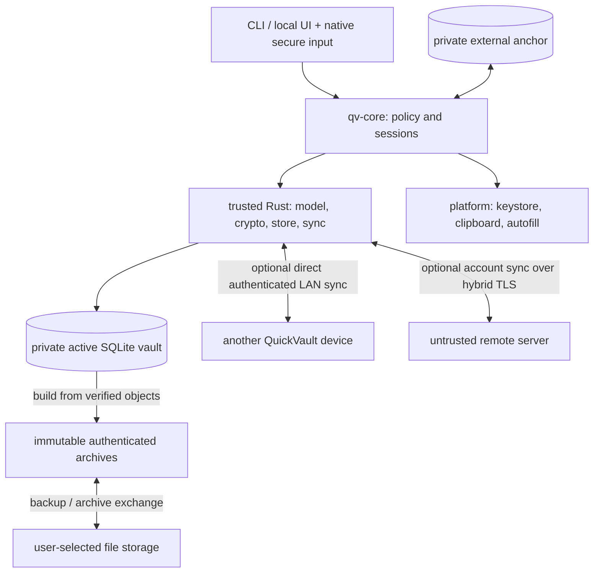

# QuickVault Architecture

QuickVault is an offline-first, end-to-end encrypted password manager with
optional synchronization. The normative specifications are in
[specs/](specs/README.md). This repository currently specifies the design;
it does not yet contain production clients or a server.
Contributor and agent workflow (plans, reviews, documentation duties) is in
[AGENTS.md](AGENTS.md); repository-level changes are in [CHANGELOG.md](CHANGELOG.md).

## 1. Goals and scope

Store generic secrets in nested groups, work fully offline, and provide
recoverable edits and explicit conflicts. A complete local vault requires no
account, server, Internet connection or network enrollment. Synchronization is
optional, with two independent modes:

- **LAN sync:** direct peer-to-peer synchronization between devices on the same
  network, without an account, remote server or Internet access.
- **Remote sync:** synchronization through an untrusted server using an account;
  any enrolled device authorized for a vault may initiate synchronization.

A vault may use neither mode, either mode, or both. Local reads and edits never
wait for a network operation; account/session expiry and server outages do not
disable local vault access or LAN sync. Server-mediated devices need not be
online at the same time; LAN peers must be available together.

Initial LAN and remote synchronization is manual: the user explicitly starts
an exchange. Unlocking, editing, login, timers and connectivity changes do not
trigger synchronization. Pending changes wait for the next explicit sync;
bounded retries may occur within an active operation. Automatic sync and
background retry scheduling are deferred (0005 §0.5).

Android is a primary app target alongside the Linux companion. Build the shared
offline Rust core with an early Linux CLI and Android/Linux app validation;
mobile work does not wait for the full CLI or the remote server. The app uses
a shared cross-platform UI codebase, with platform integration isolated behind
adapters. iOS is a later target, not an initial delivery requirement. Security
includes metadata confidentiality, hostile-input handling and OS integration.

v1 excludes cross-user sharing, a browser extension, auto-type, key files,
hardware-token authentication and hosted open registration. These are separate
future designs, not requirements to prebuild into every subsystem.

## 2. Design decisions

1. **Untrusted storage.** Server data is ciphertext plus the random references,
   liveness, sizes, generations and timing needed to store it; object routing
   data cannot link objects to records or histories. Clients verify
   authenticated manifests; TLS and server authorization are not vault integrity.
2. **Private active DB, immutable archives.** A vault is SQLite with encrypted
   objects. Snapshots, backups and Dropbox/Syncthing exchange use one simple
   archive format, authenticated before parsing; attacker-supplied files never
   reach the SQLite parser. Never synchronize or replace the actively opened DB.
   Exchange archives carry no password slot and open only with VK (another
   device or the recovery phrase); rollback detection also requires a
   separately remembered anchor.
3. **Independent immutable crypto profiles.** KDF, data, wrapping, signatures
   and account authentication evolve separately. Changing KDF cost does not
   require migrating unrelated protocols. Data migration creates a new key
   generation with an explicit resumable transition.
4. **Causal whole-record conflicts.** Merge maximal version-vector heads without
   creating synthetic edits. Preserve concurrent credentials intact and require
   explicit resolution. Dates are display data, not replay protection.
5. **Exact references and honest guarantees.** Manifests cover active versions,
   retained history, chunks and permanent tombstones. A remote state must
   causally contain the remembered one ("the remote never forgets"), and a
   one-step local anchor detects known local regressions. Isolated server forks
   or freezes need independent checkpoint comparison; automatic global freshness
   is not promised.
6. **Minimize plaintext.** qv-core owns session/authorization policy; the trusted
   client includes the Rust subsystems, platform adapters and privileged frontend.
   Protected values stay encrypted when idle, native secure controls collect
   secret input, and clipboard/autofill bypass the webview. Handles reduce copies
   but do not isolate secrets from a compromised authorized UI.
7. **Reviewed building blocks and compositions.** Use reviewed implementations,
   recorded versions/audits and vectors. The pairing/session/migration protocols
   still require independent review. Memory safety and encryption do not replace
   hostile SQLite/CBOR/rendering-input defenses.

## 3. Components and trust boundaries

These are logical subsystems; split physical crates as interfaces stabilize
rather than creating unused workspace scaffolding.

| Component | Responsibility |
|-----------|----------------|
| qv-encoding | Bounded deterministic CBOR (0004 §3.1): validates hostile input before typed reads, encodes only canonical items, builds AAD/info/transcript arrays; depends on no other qv crate |
| qv-crypto | Profiles, key hierarchy, encryption, signature verification, protected memory |
| qv-model | Canonical payloads, atomic records, deterministic tree projection |
| qv-store | Hardened SQLite, immutable objects, manifests, transactions, archives |
| qv-protocol | Bounded canonical LAN/server wire types, contexts and version registry |
| qv-sync | Shared causal merge, direct LAN exchange, remote candidate state and publication orchestration |
| qv-core | Session policy, handles, lock cancellation, mutation authorization |
| qv-platform | Native secure input, keystore, clipboard, verified OS autofill |
| qv-cli / qv-app | Explicit user actions and views; no unrestricted crypto/file/SQL bridge |
| qv-server (optional) | Remote-sync accounts, grants, sessions, opaque objects, atomic checkpoint publication |

Implemented so far: `qv-encoding` (canonical CBOR codec, fuzzed in CI) and
`qv-crypto` (protected memory, process hardening, OS RNG, profile registry,
symmetric primitives, key hierarchy, password slots, the recovery phrase and
the password generator; frontends will reach the generator through `qv-core`)
and `qv-model` (records and payloads, version vectors, merge, history floors,
group-tree projection and TOTP) and `qv-store` (the hardened vault file with
its header and local keyslots; unlinkable encrypted objects, the encrypted
manifest, the authenticated local head and the per-replica external anchor;
writer state; creation, verified unlock with explicit anchor recovery, and
the single mutation transaction) and `qv-core` (sessions with lock,
cancellation and session-scoped handles, mutation authorization, the bounded
metadata index and search over non-protected fields, on-demand decryption,
causal entry/group edits, the trash with final tombstones, read-only conflict
surfacing and vault settings including generator defaults, plus the
unverified header view and the zxcvbn master-password estimate) and `qv-cli`
(`qvault` with `init`, `info`, `ls`, `search`, `show`, `totp` and `generate`;
secret-safe prompts, escaped and JSON output, exit codes).
Other components are planned and are created by the roadmap phase that first
needs them.

Frontends call qv-core. Core injects platform traits and orchestrates model,
store, crypto and sync. Crypto/model have no dependency on frontends. Server
uses protocol types and public-key verification libraries; its inability to
decrypt rests on key custody, not a missing Cargo dependency.

`qv-app` shares screens, navigation, application state and vault workflows across
Android and Linux, with responsive layouts for touch and desktop. `qv-platform`
isolates OS integration such as secure input, key storage, biometrics, clipboard,
lifecycle and autofill entry points. Prefer validated framework APIs or reviewed
libraries where they meet the security contract; keep necessary native glue
small. A shared framework does not remove platform-specific packaging and
validation, and does not require separate application implementations per OS.

No plaintext or device-bound credentials go into archives. Only an explicitly
self-contained backup carries a password slot, so whoever holds that file can
attempt offline guessing. The native/OS memory conditions of 0008 qualify
locked-device protection.

LAN connectivity and discovery do not establish peer trust. Peers must be
explicitly authorized for the vault; network input remains hostile. LAN sync
does not use server accounts, sessions or grants. Exact discovery, enrollment
and session protocols remain open in 0005 §6 and must be specified and reviewed
before implementation. Snapshot exchange is a backup/interoperability utility,
not a third live network sync mode.

## 4. Key hierarchy and lifecycle

Each vault has a random 256-bit VK, encoded directly as a 24-word recovery
phrase. Argon2id derives a password KEK that wraps VK. Independently derived
purpose keys protect records, attachments, manifests, headers, checkpoints and
local state. Platform quick-unlock envelopes use supported OS algorithms rather
than requiring XChaCha hardware support.

Changing the master password replaces a complete keyslot but does not revoke
a copied old slot or rotate VK. Compromise recovery creates a new VK/generation,
reencrypts retained data, changes recovery verification keys, invalidates old
grants and peer approvals, and requires fresh out-of-band approval of remaining
devices. It cannot
erase secrets already copied. See [0002](specs/0002-cryptography.md).

## 5. Main flows

**Unlock:** harden/validate SQLite and enforce resource/profile limits; unwrap
VK; verify header, complete manifest and external anchor; expose bounded
metadata views and session handles. Protected values are decrypted on demand.

**Edit:** create an immutable causal version; persist objects, manifest, history
suppression, outbox and the next authenticated local head in one transaction.
Advance the external anchor durably before reporting success; a crash between
the two is recovered because the head names the anchor's digest.

**LAN sync:** connect directly to an approved same-network peer while both
vaults are unlocked. Exchange bounded authenticated manifests and immutable
objects, merge complete causal versions, and commit through the normal local
transaction/anchor path. Each device retains its local edits and deletion
knowledge; interrupted exchange is safe to retry. No server checkpoint is
advanced by a LAN exchange.

**Remote sync:** stage and verify the remote state against the remembered remote
base (no lower sequence; every remembered head, tombstone and floor still
covered), excluding unpublished local edits. v1 has one server per vault. Merge
into a candidate, preserve
complete concurrent heads, and publish through atomic idempotent compare-and-swap.
Current reference lists pin data during server garbage collection. Any authorized
enrolled device may start a round; LAN-received edits can subsequently be
published through the same remote protocol.

**File exchange:** publish unique immutable archives; authenticate private
copies of incoming archives and merge same-generation versions. Tombstones never
expire and old files cannot reintroduce suppressed history.

**Server device pairing (0006):** scan a QR with a pairing secret and
approving-key fingerprint.
Both screens show a comparison code; one request per ticket. Use a fresh
ephemeral X-Wing recipient key, encrypt the complete vault-key payload,
authenticate the full transcript, and convey trusted checkpoints. Grant only
explicitly approved vault generations.

**Server revocation:** invalidate existing sessions, grants and pending transfers
atomically; check revocation on every operation and before publication. Rotate
VK if the departed device may hold it. Server revocation does not revoke a
device's LAN access or erase its keys; LAN peer removal requires a separate
policy (0005 Open Questions).

**Server-only recovery:** requires the separate account login plus a matching
vault recovery phrase. Without a trusted checkpoint, freshness starts unverified.
A vault master password alone cannot bootstrap a new device from the server.

## 6. Technology choices

| Concern | Choice |
|---------|--------|
| Language | Stable Rust; toolchain pinned to 1.98.1 (`rust-toolchain.toml`), which is the MSRV |
| Build / CI | Cargo virtual workspace (`crates/<name>/`); GitHub Actions with SHA-pinned actions running the gates, `cargo deny` and `cargo vet` |
| UI | Shared Dioxus app/UI for Android and Linux, subject to early framework validation; native secure-input/OS adapters; iOS later |
| Optional remote server | Axum/Tokio; SQLite first, Postgres deferred |
| Local storage | rusqlite with bundled SQLite 3.53.2 and trimmed compile options (`.cargo/config.toml`), encrypted immutable objects and manifests; external anchors as per-replica files in the private state directory (`$XDG_STATE_HOME/quickvault/anchors` on Linux; keystore-backed where available later) |
| Serialization | Bounded RFC 8949 deterministic CBOR |
| Data encryption | XChaCha20-Poly1305 |
| Password KDF / derivation | Argon2id / HKDF-SHA-512 |
| Server enrollment | Pinned X-Wing draft-11 plus authenticated encryption/transcript |
| Application signatures | Ed25519 + ML-DSA-65, both required |
| Remote transport | TLS 1.3, X25519MLKEM768, pinned application server identity |
| Remote account authentication | Pinned RFC 9807 OPAQUE application profile |
| Direct LAN discovery / enrollment / transport | Not yet selected; requirements and open decisions in 0005 §6 |
| CLI / license | clap (builder API), rustix termios for no-echo prompts, own escaping and JSON writer; `zxcvbn` (in `qv-core`) for typed master passwords / AGPL-3.0-or-later |

OPAQUE and ordinary TLS certificates are explicit classical exceptions.
TLS-bound opaque sessions replace custom per-request HMAC/counter signing.
KDF benchmarks and protocol review are release requirements, not completed work.

Dioxus remains the planned framework, not a validated password-manager platform.
Evaluate Android and Linux builds, native secure-input integration, lifecycle,
keystore/biometric access and autofill entry-point feasibility early (0009 §6).
The existing webview-versus-native-renderer question remains open; changing the
framework or relaxing security requirements needs an explicit owner decision.

## 7. Delivery and validation

| Phase | Deliverable |
|-------|-------------|
| 1 | Shared offline Rust core and early Linux CLI: encrypted vault, manifests, anchors, bounded history/recovery; early Android/Linux shared-UI and platform-adapter feasibility work |
| 2 | Usable offline Android and Linux apps from the shared UI; validated native input/lifecycle, Android quick unlock/autofill as their gates pass, manually initiated direct LAN sync, conflicts and archive exchange; LAN protocol decisions/review required first |
| 3 | Optional closed self-hosted remote server, manually initiated remote sync, accounts, device grants/sessions, server pairing/recovery and remote generation transitions |
| 4 | Windows |
| Later | Automatic sync (separate design), third-party import/export, hosted admission, iOS/macOS, extensions and BSD |

The phased implementation roadmap for these milestones is
[plans/0002-roadmap](plans/0002-roadmap/PLAN.md).

Future implementations must satisfy the acceptance criteria in
[0012 — Security Validation](specs/0012-security-validation.md).
These are specification requirements; no implementation or security validation
has been completed by documenting them.

Remaining implementation work includes KDF/mobile-budget benchmarks, reviewed
platform-wrap backends, native-input lifecycle validation, and independent
protocol review. A witness service is optional future work; v1's documented
fork/freeze limits do not depend on pretending it exists.

Offline release is independent of both network modes. LAN sync must be usable
without deploying phase 3; each sync mode has its own release evidence in 0012.
Android development and its offline release do not depend on the remote server
or iOS support. Unsupported quick unlock/autofill remains disabled until its
platform gates pass; do not weaken unlock policy to complete an app milestone.

Open design decisions recorded for the owner (not yet decided):
whether per-device signing identities are worth their complexity
([0006](specs/0006-server-authentication.md) OQ2), webview versus native Rust UI
([0008](specs/0008-memory-and-side-channels.md) OQ2), and password slots in local
snapshots ([0007](specs/0007-history-and-backups.md) OQ1), plus LAN discovery/addressing,
authenticated peer enrollment/session design, local peer-state persistence,
LAN listening lifecycle and peer removal ([0005](specs/0005-synchronization.md)
OQ3–OQ6). No LAN wire protocol has been selected by this direction change.
