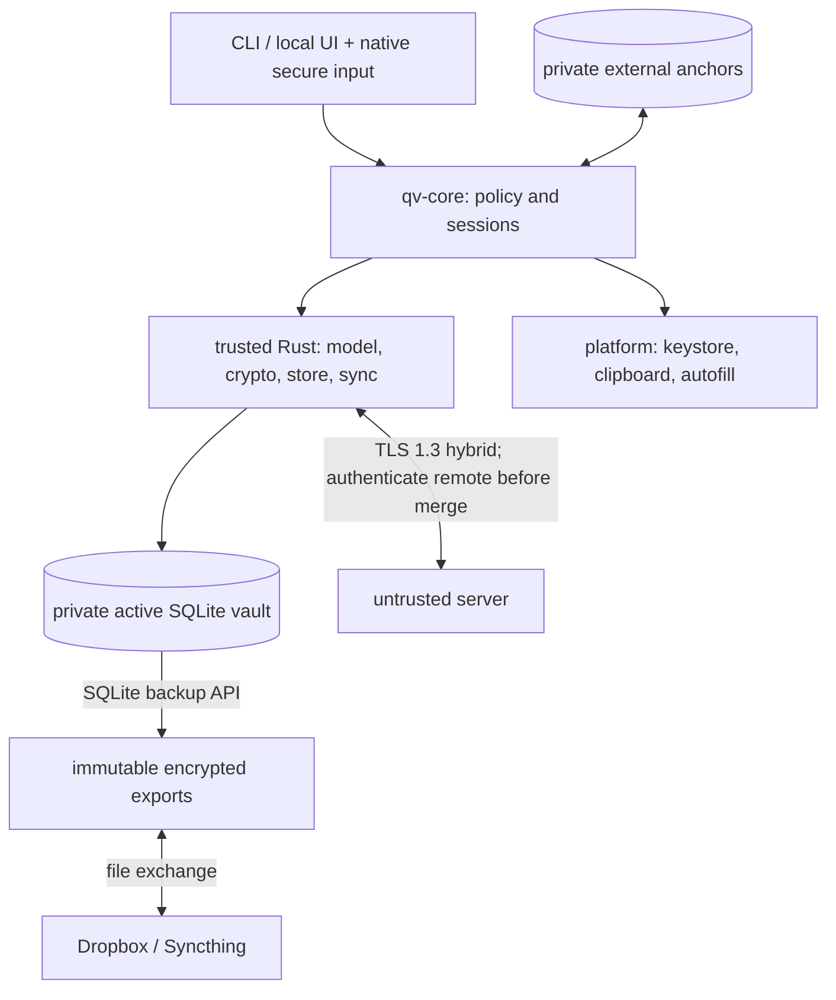

# QuickVault Architecture

QuickVault is an offline-first, end-to-end encrypted password manager with
optional synchronization. The normative specifications are in
[specs/](specs/README.md). This repository currently specifies the design;
it does not yet contain production clients or a server.

## 1. Goals and scope

Store generic secrets in nested groups, work fully offline, provide recoverable
edits and explicit conflicts, and optionally sync through an untrusted server.
Linux CLI comes first, followed by desktop and mobile clients. Security includes
metadata confidentiality, hostile-input handling and practical OS integration.

v1 excludes cross-user sharing, a browser extension, auto-type, key files,
hardware-token authentication and hosted open registration. These are separate
future designs, not requirements to prebuild into every subsystem.

## 2. Design decisions

1. **Untrusted storage.** Server data is ciphertext plus the random references,
   liveness, sizes, generations and timing needed to store it. Clients verify
   authenticated manifests; TLS and server authorization are not vault integrity.
2. **Private active DB, immutable exchange.** A vault is SQLite with encrypted
   objects. Export through the backup API into new immutable files for Dropbox/
   Syncthing exchange. Never synchronize or replace the actively opened DB.
   A consistent export plus its password or recovery phrase decrypts the data;
   rollback detection also requires separately remembered checkpoints.
3. **Independent immutable crypto profiles.** KDF, data, wrapping, signatures
   and account authentication evolve separately. Changing KDF cost does not
   require migrating unrelated protocols. Data migration creates a new key
   generation with an explicit resumable transition.
4. **Causal whole-record conflicts.** Merge maximal version-vector heads without
   creating synthetic edits. Preserve concurrent credentials intact and require
   explicit resolution. HLCs/dates are display data, not replay protection.
5. **Exact references and honest guarantees.** Manifests cover active versions,
   retained history, chunks and permanent tombstones. Checkpoint ancestry and
   external anchors detect known regressions. Isolated server forks or freezes
   need independent checkpoint comparison; automatic global freshness is not
   promised.
6. **Minimize plaintext.** qv-core owns session/authorization policy; the trusted
   client includes the Rust subsystems, platform adapters and privileged frontend.
   Protected values stay encrypted when idle, native secure controls collect
   secret input, and clipboard/autofill bypass the webview. Handles reduce copies
   but do not isolate secrets from a compromised authorized UI.
7. **Reviewed building blocks and compositions.** Use reviewed implementations,
   recorded versions/audits and vectors. The pairing/session/migration protocols
   still require independent review. Memory safety and encryption do not replace
   hostile SQLite/CBOR/rendering-input defenses.

## 3. Components and trust boundaries

These are logical subsystems; split physical crates as interfaces stabilize
rather than creating unused workspace scaffolding.

| Component | Responsibility |
|-----------|----------------|
| qv-crypto | Profiles, key hierarchy, encryption, signature verification, protected memory |
| qv-model | Canonical payloads, atomic records, deterministic tree projection |
| qv-store | Hardened SQLite, immutable objects, manifests, transactions, backup exports |
| qv-protocol | Bounded canonical wire types, contexts and version registry |
| qv-sync | Causal merge, remote candidate state and publication orchestration |
| qv-core | Session policy, handles, lock cancellation, mutation authorization |
| qv-platform | Native secure input, keystore, clipboard, verified OS autofill |
| qv-cli / qv-app | Explicit user actions and views; no unrestricted crypto/file/SQL bridge |
| qv-server | Accounts, grants, sessions, opaque objects, atomic checkpoint publication |

Frontends call qv-core. Core injects platform traits and orchestrates model,
store, crypto and sync. Crypto/model have no dependency on frontends. Server
uses protocol types and public-key verification libraries; its inability to
decrypt rests on key custody, not a missing Cargo dependency.

No plaintext or device-bound credentials go into exports. Explicit self-contained
exports do contain a password slot, so their provider can attempt offline guessing.
The native/OS memory conditions of 0008 qualify locked-device protection.

## 4. Key hierarchy and lifecycle

Each vault has a random 256-bit VK, encoded directly as a 24-word recovery
phrase. Argon2id derives a password KEK that wraps VK. Independently derived
purpose keys protect records, attachments, manifests, headers, checkpoints and
local state. Platform quick-unlock envelopes use supported OS algorithms rather
than requiring XChaCha hardware support.

Changing the master password replaces a complete keyslot but does not revoke
a copied old slot or rotate VK. Compromise recovery creates a new VK/generation,
reencrypts retained data, changes recovery verification keys, invalidates old
grants, and requires fresh out-of-band approval of remaining devices. It cannot
erase secrets already copied. See [0002](specs/0002-cryptography.md).

## 5. Main flows

**Unlock:** harden/validate SQLite and enforce resource/profile limits; unwrap
VK; verify header, complete manifest and external anchor; expose bounded
metadata views and session handles. Protected values are decrypted on demand.

**Edit:** create an immutable causal version; persist objects, manifest, history
suppression, outbox and pending anchor transition in one transaction. Advance
the external anchor durably before reporting success.

**Sync:** stage and verify the remote state against the remembered remote
checkpoint, excluding unpublished local edits. Merge into a candidate, preserve
complete concurrent heads, and publish through atomic idempotent compare-and-swap.
Current reference lists pin data during server garbage collection.

**File exchange:** publish unique consistent encrypted exports; verify private
copies of incoming files and merge same-generation versions. Tombstones never
expire and old files cannot reintroduce suppressed history.

**Device pairing:** scan a QR with a pairing secret and approving-key fingerprint.
Use a fresh ephemeral X-Wing recipient key, encrypt the complete vault-key payload,
authenticate the full transcript, and convey trusted checkpoints. Grant only
explicitly approved vault generations.

**Revocation:** invalidate existing sessions, grants and pending transfers
atomically; check revocation on every operation and before publication. Rotate
VK if the departed device may hold it.

**Server-only recovery:** requires the separate account login plus a matching
vault recovery phrase. Without a trusted checkpoint, freshness starts unverified.
A vault master password alone cannot bootstrap a new device from the server.

## 6. Technology choices

| Concern | Choice |
|---------|--------|
| Language | Stable Rust |
| UI | Dioxus for main UI, native secure-input/OS adapters |
| Server | Axum/Tokio; SQLite first, Postgres deferred |
| Local storage | rusqlite, encrypted immutable objects and manifests |
| Serialization | Bounded RFC 8949 deterministic CBOR |
| Data encryption | XChaCha20-Poly1305 |
| Password KDF / derivation | Argon2id / HKDF-SHA-512 |
| Enrollment | Pinned X-Wing draft-11 plus authenticated encryption/transcript |
| Application signatures | Ed25519 + ML-DSA-65, both required |
| Transport | TLS 1.3, X25519MLKEM768, pinned application server identity |
| Account authentication | Pinned RFC 9807 OPAQUE application profile |
| CLI / license | clap / AGPL-3.0-or-later |

OPAQUE and ordinary TLS certificates are explicit classical exceptions.
TLS-bound opaque sessions replace custom per-request HMAC/counter signing.
KDF benchmarks and protocol review are release requirements, not completed work.

## 7. Delivery and validation

| Phase | Deliverable |
|-------|-------------|
| 1 | Offline Linux CLI: encrypted vault, manifests, anchors, bounded history/recovery |
| 2 | Linux desktop, hardened webview/native input, immutable snapshot exchange and conflicts |
| 3 | Closed self-hosted server, device grants/sessions, pairing/recovery and generation rotation |
| 4 | Android, verified quick unlock and autofill |
| 5 | Windows |
| Later | Third-party import/export, hosted admission, iOS/macOS, extensions and BSD |

Future implementations must satisfy the acceptance criteria in
[0012 — Security Validation](specs/0012-security-validation.md).
These are specification requirements; no implementation or security validation
has been completed by documenting them.

Remaining implementation work includes KDF/mobile-budget benchmarks, reviewed
platform-wrap backends, native-input lifecycle validation, and independent
protocol review. A witness service is optional future work; v1's documented
fork/freeze limits do not depend on pretending it exists.
