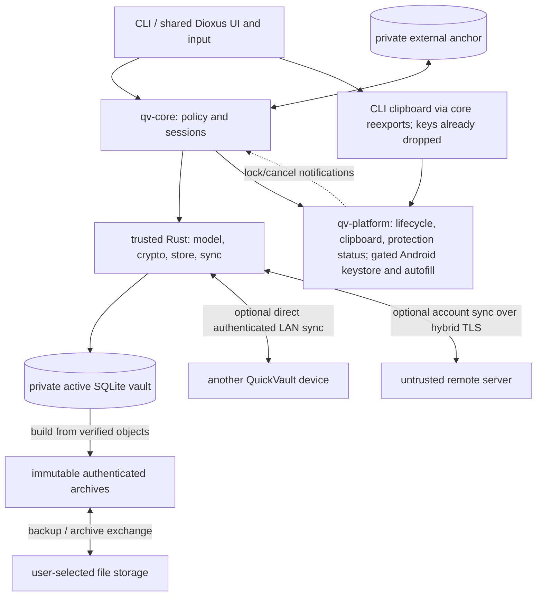

# QuickVault Architecture

QuickVault is an offline-first, end-to-end encrypted password manager with
optional synchronization. The normative specifications are in
[specs/](specs/README.md). This repository currently specifies the design;
it does not yet contain production clients or a server.
Contributor and agent workflow (plans, reviews, documentation duties) is in
[AGENTS.md](AGENTS.md); repository-level changes are in [CHANGELOG.md](CHANGELOG.md).

## 1. Goals and scope

Store generic secrets in nested groups, work fully offline, and provide
recoverable edits and explicit conflicts. A complete local vault requires no
account, server, Internet connection or network enrollment. Synchronization is
optional, with two independent modes:

- **LAN sync:** direct peer-to-peer synchronization between devices on the same
  network, without an account, remote server or Internet access.
- **Remote sync:** synchronization through an untrusted server using an account;
  any enrolled device authorized for a vault may initiate synchronization.

A vault may use neither mode, either mode, or both. Local reads and edits never
wait for a network operation; account/session expiry and server outages do not
disable local vault access or LAN sync. Server-mediated devices need not be
online at the same time; LAN peers must be available together.

Initial LAN and remote synchronization is manual: the user explicitly starts
an exchange. Unlocking, editing, login, timers and connectivity changes do not
trigger synchronization. Pending changes wait for the next explicit sync;
bounded retries may occur within an active operation. Automatic sync and
background retry scheduling are deferred (0005 §0.5).

Android is a primary app target alongside the Linux companion. Build the shared
offline Rust core with an early Linux CLI and Android/Linux app validation;
mobile work does not wait for the full CLI or the remote server. The app uses
a shared cross-platform UI codebase, with platform integration isolated behind
adapters. iOS is a later target, not an initial delivery requirement. Security
includes metadata confidentiality, hostile-input handling and OS integration.

v1 excludes cross-user sharing, a browser extension, auto-type, key files,
hardware-token authentication and hosted open registration. These are separate
future designs, not requirements to prebuild into every subsystem.

## 2. Design decisions

1. **Untrusted storage.** Server data is ciphertext plus the random references,
   liveness, sizes, generations and timing needed to store it; object routing
   data cannot link objects to records or histories. Clients verify
   authenticated manifests; TLS and server authorization are not vault integrity.
2. **Private active DB, immutable archives.** A vault is SQLite with encrypted
   objects. Snapshots, backups and Dropbox/Syncthing exchange use one simple
   archive format, authenticated before parsing; attacker-supplied files never
   reach the SQLite parser. Never synchronize or replace the actively opened DB.
   Exchange archives carry no password slot and open only with VK (another
   device or the recovery phrase); rollback detection also requires a
   separately remembered anchor.
3. **Independent immutable crypto profiles.** KDF, data, wrapping, signatures
   and account authentication evolve separately. Changing KDF cost does not
   require migrating unrelated protocols. Data migration creates a new key
   generation with an explicit resumable transition.
4. **Causal whole-record conflicts.** Merge maximal version-vector heads without
   creating synthetic edits. Preserve concurrent credentials intact and require
   explicit resolution. Dates are display data, not replay protection.
5. **Exact references and honest guarantees.** Manifests cover active versions,
   retained history, chunks and permanent tombstones. A remote state must
   causally contain the remembered one ("the remote never forgets"), and a
   one-step local anchor detects known local regressions. Isolated server forks
   or freezes need independent checkpoint comparison; automatic global freshness
   is not promised.
6. **Minimize plaintext.** qv-core owns session/authorization policy; the trusted
   client includes the Rust subsystems, platform adapters and privileged frontend.
   Protected values stay encrypted when idle; standard Dioxus controls collect
   secret input with bounded lifetimes and best-effort cleanup. Framework/OS
   copies have documented limits. Clipboard/autofill bypass the webview. Handles reduce copies
   but do not isolate secrets from a compromised authorized UI.
7. **Reviewed building blocks and compositions.** Use reviewed implementations,
   recorded versions/audits and vectors. The pairing/session/migration protocols
   still require independent review. Memory safety and encryption do not replace
   hostile SQLite/CBOR/rendering-input defenses.

## 3. Components and trust boundaries

These are logical subsystems; split physical crates as interfaces stabilize
rather than creating unused workspace scaffolding.

| Component | Responsibility |
|-----------|----------------|
| qv-encoding | Bounded deterministic CBOR (0004 §3.1): validates hostile input before typed reads, encodes only canonical items, builds AAD/info/transcript arrays; depends on no other qv crate |
| qv-crypto | Profiles, key hierarchy, encryption, protected memory, X-Wing draft-11 (libcrux-kem), the LAN record layer (0013 §6) and the one-use code key schedule (pairing keys, the `lan-proof` key and its transcript-bound proofs, the comparison code; 0013 §4); hybrid signature verification from roadmap 3.3 |
| qv-model | Canonical payloads, atomic records, deterministic tree projection |
| qv-store | Hardened SQLite, immutable objects, manifests, transactions, authenticated archives (header, writer, role-verifying reader), new-path restore and the full `verify` pass; no LAN peer state (the retired `lan_link` rows stay head-bound and clear at the next commit; 0013 §9.1), LAN serving reads, peer staging (new device, or merge with local copies of held objects) and receipt-free LAN acceptance through the archive acceptance transaction (0013 §7, §9–10) |
| qv-protocol | Key-free hostile-input wire layer: bounded LAN frames, wire labels with exact arity, exact-shape message reader/writer, `lan / 1` profile, feature and error-code registry (roadmap 2.8); typed pairing/exchange/error messages, the one-use code's QR/manual form and endpoint text (roadmap 2.9–2.10, plan 0042); server wire types later; depends only on qv-encoding |
| qv-sync | Shared causal merge candidates; LAN over TCP: the one-use sync window and the joiner in sync or new-device mode, and the two-way exchange (roadmap 2.9–2.10, plan 0042); remote candidate state and publication orchestration (planned) |
| qv-core | Session policy, handles, lock cancellation, mutation authorization, snapshot policy/budgets, the `verify` report, and LAN sync windows, sync from a code and new-device join for frontends; strict scanned QR kind/profile/address inspection without network I/O |
| qv-platform | Injected OS traits; local unicast addresses for LAN endpoints from route probes, attached networks first (`/proc/net/route` where readable; std only); Linux logind lifecycle, xdg-desktop-portal file picker (zbus, local `file:` results only), X11 clipboard ownership, single-instance and persistence reporting, no-follow explicit file input/output shared by CLI and app; Android lifecycle metadata and clipboard hold policy over an injected native backend; Android keystore quick unlock with boot-bound policy state that survives app restarts (on where the device supports it; plan 0045); Android storage evidence from the OS encryption status; exact-identity autofill matching; native input unavailable |
| qv-cli / qv-app | Explicit user actions and views, including `qv lan open|sync|join` and the app's Sync screen and Join mode; qv-app's shared UI (own title bar, one DOM for desktop and phone, 0009 §1.8), its non-secret preferences file (theme, acknowledged protection status), QR rendering/decoding and bounded native Android Camera2 glue (camera on by default; `QV_APP_QR_CAMERA=0` builds without it); in-app attachment previews decrypted only into memory and served to the webview from a one-time `/preview/` route (0003 §6.4); on Linux, portal file picks run in a re-executed helper process without vault data, since the portal refuses the non-dumpable app; no unrestricted crypto/file/SQL bridge |
| qv-server (optional) | Remote-sync accounts, grants, sessions, opaque objects, atomic checkpoint publication |

Implemented so far: `qv-encoding` (canonical CBOR codec, fuzzed in CI) and
`qv-crypto` (protected memory, process hardening, OS RNG, profile registry,
symmetric primitives, key hierarchy, password slots, the recovery phrase and
the password generator; frontends will reach the generator through `qv-core`)
and `qv-model` (records and payloads, version vectors, merge, history floors,
group-tree projection and TOTP) and `qv-store` (the hardened vault file with
its header and local keyslots; unlinkable encrypted objects, the encrypted
manifest, the authenticated local head and the per-replica external anchor;
writer state; creation, verified unlock with explicit anchor recovery, and
the single mutation transaction, plus bounded authenticated attachment chunks, the authenticated archive reader/writer and the read-only full `verify` pass) and `qv-core` (sessions with lock,
cancellation and session-scoped handles, mutation authorization, the bounded
metadata index and search over non-protected fields, on-demand decryption,
causal entry/group edits, the trash with final tombstones, read-only conflict
surfacing and vault settings including generator defaults, plus the
unverified header view, the zxcvbn master-password estimate, session-bound
streaming attachment operations, local snapshot policy/budgets with their
authenticated listing, and the `verify` report) and `qv-cli`
(`qv` with `init`, `info`, `ls`, `search`, `show`, `totp`, `generate`,
`add`, `edit`, `mv`, `mkdir`, `rm`, `trash ls|restore|empty`,
`snapshot ls|restore`, `verify`, `copy` and
`totp`/`generate --copy`, `attach add|ls|save|rm`; protected
prompts/notes, signal cancellation and terminal restoration, escaped and JSON
output, exit codes). The shared qv-platform Linux X11 clipboard adapter (including usable
XWayland) drops keys/metadata before foreground serving, uses the published
x11rb 0.13.2 over QuickVault's own bounded transport (lifetime read budget,
X11 framing check refusing packets over 1 MiB before x11rb allocates, received
descriptors refused, deadlines/cancellation) and bounded incoming/INCR state,
and releases only its own window. x11rb's ordinary send buffer briefly holds a
copied value (documented best-effort library intermediate, 0008 §4.4; plan
0032). Native Wayland is not implemented; OS/recipient/manager copies remain
outside application erasure control.
Roadmap 2.8 adds:
- `qv-protocol`: the key-free LAN wire layer (bounded frames, the wire-label
  and arity registry, exact-shape messages, profile, feature and error-code
  registry);
- in `qv-crypto`: the X-Wing KEM and the 0013 §6 record layer.

Roadmap 2.9 (plan 0037) adds LAN pairing (0013 §4, §8–10, §12):
- qv-crypto: the pairing key schedule;
- qv-store: `lan_link` rows bound to the head by key 8
  `lan_links_digest` (format `0x7FFF0004`), serving reads, and new-device
  staging. A joining device writes the received manifest and objects as a
  private archive, authenticates it with the archive reader, and creates the
  vault through the new-path restore protocol with its link in the first
  head;
- qv-sync: the pairing window (one session at a time, 16 failures,
  second-hello detection, time limit, prompt cancellation), the joiner and
  the new-device exchange;
- qv-core: the frontend API. The session mutex is held only for short reads
  and the link commit.

Rotation and restore start with no links. No independent review exists yet
(D12).

Roadmap 2.10 (plan 0038) makes LAN sync usable (0013 §5, §7, §8):
- qv-sync: the session handshake under one link per attempt, the two-way
  exchange, receive windows and the initiator. A link-mode pairing is
  followed by one exchange over the pairing keys;
- qv-store: each side stages the peer's state as a private archive. Objects
  it holds identically are copied from its own rows and the rest requested.
  The archive authenticates as a whole before the merge commits through the
  archive acceptance transaction, without a filename receipt. A peer with
  nothing new commits nothing;
- qv-core: receive windows and sync rounds. Local acceptance, conflicts and
  peer receipt are reported separately, and the ordinary snapshot coalescing
  runs before a merge;
- qv-platform: local addresses from route probes;
- qv-cli: `qv lan pair|join|receive|sync|links|unlink` and exit code 10;
- qv-app: the Sync screen and Join mode, whose prompts are answered while
  the operation waits on its worker. Only bounded listeners without a pending
  question defer idle locking; prompts and initiated operations retain it.
  Window expiry caps transport, snapshot copying and acceptance. Local
  acceptance metadata is captured before releasing the session so reporting
  survives lock; completion errors remain visible alongside committed results.

Plan 0042 (spec 0014, owner direction 2026-11-06) replaces the links,
session handshake and receive windows above with one-use sync windows:
sync mode proves VK possession bound to the pairing transcript and runs one
exchange; new-device mode keeps the comparison code; nothing about a peer is
stored (the `lan_link` rows and digest stay in the format, always empty
after a commit). The CLI is `qv lan open|sync|join`, and in the app a
scanned code that names its address starts the sync or join at once.

DNS-SD discovery stays deferred (owner decision 2026-11-03). Roadmap 2.10b
(plan 0039) adds protected binary pairing/address QR display in the shared app,
with bounded grayscale decoding and strict core inspection. Android Camera2
runs an in-memory preview in the existing activity, with action-only permission
and cancellation on lock/pause/expiry. Since plan 0042 a scanned code that
names its address starts its sync or join (the scan is the explicit action),
and one without an address fills the form; there is one QR kind. Manual input remains available; endpoints are action-local.
The camera remains disabled in ordinary packages until actual-device validation;
explicit validation packages can exercise it. Step 6 of plan 0039 carries both
2.10's outstanding offline-LAN run and the QR/device checks at the owner's request.
No new component or trust boundary is introduced; library/OS/renderer cleanup is
best effort. The independent protocol/platform release gates remain open.
Attachment content uses existing per-attachment keys, fixed full-chunk framing
and canonical chunk AAD, with ciphertext reference/hash checks, per-chunk AEAD
and whole-content SHA-256/length verification. Imports stage encrypted objects
inside the existing transaction/anchor path; removal uses causal tombstones and
reference pruning. Protected chunk buffers bound working content memory instead
of accumulating entire attachments. CLI save confirms explicit plaintext export,
verifies before creating a new owner-only file and authenticates again while
streaming. It never overwrites or chooses paths from stored metadata; failure or
crash may leave incomplete plaintext at the explicit destination. No secure-
erasure or atomic export-completion claim is made.
History retention now targets ten dominated versions per record under existing
resource budgets and conservative monotonic suppression floors. Floor-only purge
and retention share the existing manifest/transaction/anchor path, never prune
active heads or tombstones, and filter suppressed heads when later dominated.
Core exposes bounded authenticated historical metadata, separate session-bound
historical reveal capabilities and intentional restore as a new causal edit.
The CLI provides `history`, `history show`, `restore` and `history purge`, with
explicit conflict-restoration consent and purge confirmation. Writer vectors
are not attributed to invented device identities. Local purge is logical
suppression, not erasure of snapshots, unseen concurrent history or independent
copies. Configurable history-depth settings remain reserved; the implemented
target is the default ten, which is not permission to violate safe floors.
Password change and recovery (plan 0020, phase 1.14) now use the same durable
mutation path: the complete operational password slot, encrypted causal keyslot
record and header MAC change atomically, preserving VK, generation and existing
data object envelopes. Core exposes current-password reauthentication for phrase
redisplay and phrase-based unlock of an existing local vault. CLI `passwd`,
`recovery show` and `recover <path>` use protected terminal input; redisplay uses
the alternate screen. A missing/mismatched anchor requires explicit recovery
baseline consent and a verified recovery snapshot before adoption. Password
replacement offers deletion of the named pre-change local snapshots only after
separate confirmation. Old slots, retained copies and independent snapshots
remain capable of disclosing the same VK; deletion is not cryptographic erasure.
The current registry still has only KDF/wrap profile 1; rewrapping exercises the
KDF-only path without inventing a second profile. Standalone phrase-based archive
import and remote credential adoption remain future work.
Rotation foundation (plan 0021, phase 1.15a) adds a bounded, canonical intent
container with independently verified old/new local-state MACs. The container
holds fixed-size metadata, never a key, password slot or path, and does not
authorize installation. An existing `.qvrotate` sibling excludes ordinary
open/create/restore and mutation paths before SQLite/anchor changes, even
when the active path is absent.
Phase 1.15b (plan 0022) builds the private replacement of the next generation.
`UnlockedVault::prepare_rotation` reencrypts every retained object under a new
VK with fresh object IDs, keeps every version ID, clock, floor and conflict, and
adds one causal keyslot edit. It writes a head at generation +1 and sequence +1
that names the old digest. It then reopens the persisted file hardened, unlocks
its new password slot and compares it fully with the source, without reading or
writing the shared anchor. Ordinary opens refuse every `.qvrotate` name, so an
orphaned replacement or retained old copy can never advance that anchor. A
per-generation snapshot inventory, MAC'd with the new local-state key, records
earlier-generation snapshots (authenticated with the old VK) for budget
accounting. A row's file is removed only when its hash matches.
Phase 1.15c (plan 0023) publishes the replacement. In order: name the
candidate, publish the next inventory, then the journal (also the marker),
retire the active file to `-old-` and move the candidate in, both with
no-replace renames, advance the anchor by its generation step, then remove
the old file, the old inventory and the journal last. On restart, the
locked journal is checked against every copy, each authenticated with its own
password, and against the anchor. The rotation then completes or rolls back;
a rollback is refused once the anchor names the new head. Core pins the
mandatory recovery snapshot, consumes the session and installs only after
three phrase words are confirmed. Snapshot policy counts inventoried copies
of older generations and removes one only when its hash matches. A missing
inventory fails closed. `qv recovery rotate` drives both the new and the
resumed flow. The owner-approved
0002 amendment defers offline-only recovery public-key derivation until sync
uses the identities; the independent seeds still change with the new VK.

Local snapshots (0007 §3) are archives built only from verified objects: the
live SQLite file is never copied or normalized, and no password slot is
written. On unlock, core may take one ordinary snapshot per hour and one on the
first unlock of a UTC day, deciding from authenticated archive headers in the
private snapshot directory only — no marker row, settings row or vault commit
on a read command. Budgets are 30 days, 48 ordinary snapshots and 512 MiB,
pruned oldest first; a recovery copy pinned by an in-progress destructive
operation is never pruned, and a `recover-` file left by a crash is reclassified
before pruning. `trash empty` writes and verifies a recovery copy before its
purge commits: a copy that cannot be written aborts the deletion with nothing
purged, and exceeding the ordinary budget requires explicit approval.
`qv verify` is a read-only full re-hash/authentication pass that reports the
local head and the anchor comparison; it never repairs, and the documented
remedy for a failure is `snapshot restore <id> <new-path>`. Restore authenticates
all archived records, history and attachment content, preserves the manifest's
history/floors/tombstones and writes a new private vault via the existing
creation protocol. It uses fresh local replica/writer/head/anchor state and the
snapshot's password slot; the active vault and its external anchor remain
unchanged. It establishes an explicit recovery baseline, not global freshness.
Restore defers automatic pruning until its selected input is safely restored.
Archive verification uses bounded seek passes over encrypted frames and checks
complete-envelope commitments between passes; no plaintext is staged on disk.
Snapshot failures and budget skips are warnings on stderr and never fail the
requested command. Archives carry no device-local slots, keys, session tokens,
sync state or anchors; hosts, other media and independent copies remain outside
application control, so no erasure is claimed.
The isolated `spikes/ui-feasibility/` crate is a non-production Dioxus
prototype with standard webview input and a qv-core fixture controller. Its
controller tests and real Linux/Android create/edit/reopen, Android background
lock/screenshot blocking, and bounded unlock measurements pass (plan 0013).
OS probes establish availability only; production adapter/webview validation
remains. Four dependency advisory exceptions and initial vet exemptions are
spike-only. It is outside default workspace members and is not a shipped frontend.
Other components are planned and are created by the roadmap phase that first
needs them.

Roadmap 2.2a (plan 0026) adds `qv-sync`'s shared candidate merge and
`qv-store::VerifiedIncoming`, an authenticated read capability over a bounded
private encrypted archive copy. The private copy is unlinked before writing;
a crash in the creation/unlink gap can leave an empty temporary file. Its
reader rechecks complete-envelope commitments and role-bound AEAD on later
reads. Candidates join complete versions and suppression floors, preserve
conflicts, and map every retained object/chunk to its source without generating
versions or changing ciphertext. They hold validated metadata, not publication
authority. Logical duplicate identity comparisons use confidential SHA-256
digests and constant-time comparison. Permanent tombstones now have explicit authenticated role markers and remain
retained even as dominated, floor-covered history. Retention, purge, later final
deletion and rotation preserve those roles; payload-history views omit their
non-restorable metadata.

Roadmap 2.2b (plan 0027), recombined at the owner's direction, adds bounded
sealed `archive_receipts` with protected canonical raw paths and complete-stream
digests, bound to the local head and replica/generation. VerifiedIncoming opens
every source component through pinned no-follow directory descriptors and owns
its normalized receipt name. qv-sync computes candidates through transaction-local
reads; qv-store independently validates the complete conservative projection and
rechecks object/role/chunk commitments before acceptance. Objects, receipt envelope,
manifest and head share the existing Write commit, followed by the anchor.
Identical redelivery creates no new commit; pending anchors finish first.
Working local password slots, writer counters and remote checkpoints remain
unchanged by receipt. Creation/restore/rotation initialize fresh empty receipts.
The volatile schema/header is 0x7FFF0003 and manifest 0x7FFF0002, with no migration.
Roadmap 2.2c (0028) adds core/CLI archive merge, immutable export and explicit
complete-version conflict resolution. Core
serializes stable-source authentication, a mandatory recovery copy, bounded
candidate-index preflight and acceptance under its session mutex. A durable
merge installs its matching index even if anchor completion fails, and reports
that acceptance separately. Exports are slotless by default; explicitly warned
self-contained backups include the working local slot, authenticated in the
archive header. Ordinary snapshot policy continues to reject slot-bearing files.
All-kind conflict capabilities expose one bounded masked version at a time and
reject a changed inspected head set. Resolution preserves protected/unknown
payload fields in a deliberate causal edit; a later unseen edit can still
conflict. Selected operational slots require their own password and existing
header-MAC key confirmation before the shared atomic slot/record/head commit.
Attachment resolutions stream new encrypted chunk objects without shared roles;
final entry resolution refuses affected attachment conflicts and atomically
finalizes non-conflicted owned attachment metadata. Local slotless snapshot
recovery preserves conflicting keyslot heads using the authenticated source's
working slot in the new baseline. Formats stay volatile; no independent security
or release claim is implied.

Roadmap 2.3 adds qv-platform with injected secure-input, clipboard, lifecycle,
keystore and protection-status traits. Linux uses pinned zbus 6.2.0 for a
bounded system-bus logind subscription, a delay inhibitor, initial lock-state
checks and screen-lock/sleep/monitor-loss events. Core binds subscriptions to
weak references to session state; lock cancels operations and session clipboard
ownership, and dropping a session releases its watcher. No event unlocks a
session. Linux persistence probes cannot establish locked-state storage-key
custody and report reduced protection; configured core flows require explicit
acknowledgement before persistent create/unlock. The generic platform builder
retains required lifecycle attachment. The Linux app uses
`Core::with_linux_platform`: OS monitoring is an optional capability,
with explicit reduced-protection acknowledgement when missing. Observed lock/
sleep and watcher-loss events still invalidate sessions; manual and inactivity
locking work independently. An owner-only no-follow flock
provides app single-instance ownership without unlinking its lock file. Native
input and keystore wrapping fail unavailable; Linux quick unlock is disabled.
The CLI retains foreground behavior through core's shared clipboard reexports.
Roadmap 2.4 (plan 0030) adds qv-app's shared create, password unlock, phrase
recovery, explicit snapshot-backed anchor recovery and lock screens. Its
protected forms use epochs and one bounded worker; lifecycle events invalidate
pending work, clear views and prevent late results from reopening a session.
Linux startup acquires instance ownership and attempts lifecycle monitoring.
Missing OS notifications are prominently disclosed and do not prevent local
use after reduced-protection acknowledgement. Manual/idle locking remains
active; loss of an installed watcher locks existing state and permits an
explicit reduced-protection retry. Android's metadata-only adapter locks on
background,
screen-off, destroyed activity or loss of required hardening; resume never
unlocks. Private anchors and snapshots live outside the active vault; Android
uses OS no-backup storage.
Android hosts one Rust runtime per process (plan 0035): configuration changes
are handled in place, and a destroyed activity locks, acknowledges and ends
the process.
Roadmap 2.7 (plan 0034) adds Android autofill (0009 §4.4), on wherever
Android supports it since 2026-11-07 (plan 0044). A thin
Kotlin `AutofillService` detects fields and returns only an authentication
entry. Its immutable PendingIntent targets a non-exported handoff activity with
a one-shot token for one in-process request (120 s pending). Rust polls,
bounds and validates the request. `qv-platform::autofill` matches exactly:
system-reported package plus full signer set, or an exact origin from an
allowlisted browser (empty). `qv-core` lists live heads and releases values
only for the chosen head after re-matching. The shared app requires unlock and
choice; lock cancels a bound request. The handoff re-verifies signers before
returning the dataset. Digital Asset Links are deferred (network).
Roadmap 2.6 (plan 0033) adds a gated Android AES-256-GCM keystore backend:
Class 3 per-operation biometrics, separate reduced-protection device credentials,
StrongBox preferred over an equally authenticated TEE key, explicit key-policy
inspection and no software/authenticator fallback. Core reauthenticates enrollment
and uses the existing phrase/header/manifest/anchor open path, then checks the
current password-slot binding. Credential changes and rotation invalidate handles.
Envelopes and attempt/age policy stay in process memory: process restart/reboot,
seven-day maximum age, three failures or lost policy state require the master
password. Native elapsedRealtime also counts deep sleep. No token/handle is
exported, synced or backed up. Shared screens expose enrollment/disable and explicit
quick unlock; it is on wherever the device supports it (owner decision
2026-11-07, plan 0044): a key that fails the TEE/StrongBox and per-use
authentication checks is refused at enrollment.
Roadmap 2.5 (plan 0031) adds the unlocked workspace: typed epoch-checked
actions over core for browsing, editing, trash, history, conflicts, snapshots,
archives, attachments, generator, settings and credential flows; one bounded
worker whose late results are dropped after a lock; 30 s reveals and Rust→OS
clipboard holds. Prepared key rotation runs as its own controller phase
because core consumes the session. Android adds a JNI clipboard backend and
document-picker streams in packaging glue; Uris never leave Kotlin.

Dioxus 0.7.10 uses a maintained desktop integration: compiled local assets,
strict CSP, exact native origin/navigation checks, bounded typed IPC and bounded
authenticated loopback rendering. Native file-dialog/filesystem and document-eval
routes are unavailable in this configuration. Five provenance-tracked upstream
snapshots support the integration; see third-party/README.md. Application Rust
secrets use protected containers; framework/DOM/OS copies have best-effort cleanup,
not deterministic erasure. Linux real-WebKit boundary and rendered-flow tests
pass under private Xvfb. Android APKs compile and synthetic instrumentation passes on a POCO X7 Pro
(Android 15); manual device and real-desktop lifecycle evidence remain incomplete. Dependency
exemptions are development audit debt. Full vault browsing/editing belongs to
roadmap 2.5; phase 2.4 foundation is implemented, with fresh-context review pending.

Frontends call qv-core. Core injects platform traits and orchestrates model,
store, crypto and sync. Crypto/model have no dependency on frontends. Server
uses protocol types and public-key verification libraries; its inability to
decrypt rests on key custody, not a missing Cargo dependency.

`qv-app` shares screens, navigation, application state and vault workflows across
Android and Linux, with responsive layouts for touch and desktop. `qv-platform`
isolates OS integration such as secure input, key storage, biometrics, clipboard,
lifecycle and autofill entry points. Prefer validated framework APIs or reviewed
libraries where they meet the security contract; keep necessary native glue
small. A shared framework does not remove platform-specific packaging and
validation, and does not require separate application implementations per OS.

No plaintext or device-bound credentials go into archives. Only an explicitly
self-contained backup carries a password slot, so whoever holds that file can
attempt offline guessing. The native/OS memory conditions of 0008 qualify
locked-device protection.

LAN connectivity and discovery do not establish peer trust. Peers must be
explicitly authorized for the vault; network input remains hostile. LAN sync
does not use server accounts, sessions or grants. Discovery, enrollment and
sessions are specified in 0013. Pairing (roadmap 2.9) and sessions with the
exchange (roadmap 2.10) are implemented. The independent protocol review (0012 §3, D12) is
still required before any LAN release. Snapshot exchange is a backup/interoperability utility,
not a third live network sync mode.

## 4. Key hierarchy and lifecycle

Each vault has a random 256-bit VK, encoded directly as a 24-word recovery
phrase. Argon2id derives a password KEK that wraps VK. Independently derived
purpose keys protect records, attachments, manifests, headers, checkpoints and
local state. Platform quick-unlock envelopes use supported OS algorithms rather
than requiring XChaCha hardware support.

Changing the master password replaces a complete keyslot but does not revoke
a copied old slot or rotate VK. Compromise recovery creates a new VK/generation,
reencrypts retained data, changes recovery verification keys, invalidates old
grants and peer approvals, and requires fresh out-of-band approval of remaining
devices. It cannot
erase secrets already copied. See [0002](specs/0002-cryptography.md).

## 5. Main flows

**Unlock:** harden/validate SQLite and enforce resource/profile limits; unwrap
VK; verify header, complete manifest and external anchor; expose bounded
metadata views and session handles. Protected values are decrypted on demand.

**Edit:** create an immutable causal version; persist objects, manifest, history
suppression, outbox and the next authenticated local head in one transaction.
Advance the external anchor durably before reporting success; a crash between
the two is recovered because the head names the anchor's digest.

**LAN sync:** connect directly to an approved same-network peer while both
vaults are unlocked. Exchange bounded authenticated manifests and immutable
objects, merge complete causal versions, and commit through the normal local
transaction/anchor path. Each device retains its local edits and deletion
knowledge; interrupted exchange is safe to retry. No server checkpoint is
advanced by a LAN exchange. The proposed protocol is
[0013](specs/0013-lan-sync-protocol.md) (Accepted 2026-10-30; release still needs the 0012 §3 LAN gate):
- the user opens an explicit, time-boxed, one-use sync window that shows a
  code (QR or a 26-character code);
- the other device scans or types it. A copy of the same vault proves this
  generation's VK with transcript-bound MACs and syncs once; a new device
  confirms a committed comparison code before VK is transferred;
- each session uses a fresh X-Wing exchange mixed with the code's secret;
- nothing about the other device is stored, and rotation stops
  old-generation copies (amended by
  [0014](specs/0014-lan-one-scan-sync.md), 2026-11-06).

**Remote sync:** stage and verify the remote state against the remembered remote
base (no lower sequence; every remembered head, tombstone and floor still
covered), excluding unpublished local edits. v1 has one server per vault. Merge
into a candidate, preserve
complete concurrent heads, and publish through atomic idempotent compare-and-swap.
Current reference lists pin data during server garbage collection. Any authorized
enrolled device may start a round; LAN-received edits can subsequently be
published through the same remote protocol.

**File exchange:** publish unique immutable archives; authenticate private
copies of incoming archives and merge same-generation versions. Tombstones never
expire and old files cannot reintroduce suppressed history.

**Server device pairing (0006):** scan a QR with a pairing secret and
approving-key fingerprint.
Both screens show a comparison code; one request per ticket. Use a fresh
ephemeral X-Wing recipient key, encrypt the complete vault-key payload,
authenticate the full transcript, and convey trusted checkpoints. Grant only
explicitly approved vault generations.

**Server revocation:** invalidate existing sessions, grants and pending transfers
atomically; check revocation on every operation and before publication. Rotate
VK if the departed device may hold it. Server revocation does not revoke a
device's LAN access or erase its keys. LAN peer removal is local per link
(0013 §12).

**Server-only recovery:** requires the separate account login plus a matching
vault recovery phrase. Without a trusted checkpoint, freshness starts unverified.
A vault master password alone cannot bootstrap a new device from the server.

## 6. Technology choices

| Concern | Choice |
|---------|--------|
| Language | Stable Rust; toolchain pinned to 1.98.1 (`rust-toolchain.toml`), which is the MSRV |
| Build / CI | Cargo virtual workspace (`crates/<name>/`); GitHub Actions with SHA-pinned actions running the gates, `cargo deny` and `cargo vet` |
| UI | Dioxus 0.7.10, maintained hardened dioxus-desktop integration, standard webview input; shared Android/Linux screens, best-effort framework cleanup; iOS later |
| Android foundation | arm64/API 29+, pinned SDK/NDK recipe, FLAG_SECURE, metadata-only lifecycle adapter, private no-backup storage; device validation pending |
| Optional remote server | Axum/Tokio; SQLite first, Postgres deferred |
| Local storage | rusqlite with bundled SQLite 3.53.2 and trimmed compile options (`.cargo/config.toml`), encrypted immutable objects and manifests; external anchors as per-replica files in the private state directory (`$XDG_STATE_HOME/quickvault/anchors` on Linux; keystore-backed where available later) |
| Serialization | Bounded RFC 8949 deterministic CBOR |
| Data encryption | XChaCha20-Poly1305; 64 KiB attachment content chunks with fixed padded framing and streaming SHA-256 verification |
| Password KDF / derivation | Argon2id / HKDF-SHA-512 |
| Server enrollment | Pinned X-Wing draft-11 plus authenticated encryption/transcript |
| Application signatures | Ed25519 + ML-DSA-65, both required |
| Remote transport | TLS 1.3, X25519MLKEM768, pinned application server identity |
| Remote account authentication | Pinned RFC 9807 OPAQUE application profile |
| Direct LAN discovery / enrollment / transport | Specified in 0013 (Accepted): DNS-SD only during explicit windows (`_qvault._tcp`, random instance), one-use QR/manual codes with transcript-bound VK proofs (0014; no stored links), X-Wing draft-11 + HKDF-SHA-512 + MAC/1 handshake, XChaCha20-Poly1305 counter-nonce records over TCP. X-Wing is `libcrux-kem` 0.0.10 (Cryspen; its draft-06 API matches the draft-11 vectors byte for byte); framing and records in qv-protocol/qv-crypto (roadmap 2.8); pairing and sessions over `std::net` TCP and endpoint addresses from `std` route probes, with no new dependency (2.9–2.10); DNS-SD discovery deferred (owner decision 2026-11-03); QR rendering/scanning in 2.10b |
| LAN QR graphics / decoding | qrcodegen-no-heap 1.8.1 (caller-owned protected scratch) and quircs 0.10.3 (bounded grayscale/binary adapter); shared SVG display; native Android Camera2/ImageReader, no image files or Play Services; exact dependency audit debt in plan 0039 |
| Linux OS adapters | Optional logind lifecycle monitoring via zbus 6.2.0 over the fixed system-bus Unix socket; existing rustix file locks/configuration probes; shared maintained X11 clipboard; quick unlock unavailable |
| CLI / license | clap (builder API), rustix termios/poll for bounded no-echo prompts, signal-hook atomic flags for cancellation, own escaping and JSON writer, shared qv-platform X11 adapter over published x11rb 0.13.2 with QuickVault's bounded transport and framing budgets; `zxcvbn` (in `qv-core`) for typed master passwords / AGPL-3.0-or-later |

OPAQUE and ordinary TLS certificates are explicit classical exceptions.
TLS-bound opaque sessions replace custom per-request HMAC/counter signing.
KDF benchmarks and protocol review are release requirements, not completed work.

The owner selected Dioxus with standard webview input on 2026-10-26. Validate
Android/Linux builds, input cleanup, lifecycle, keystore/biometric access and
autofill entry-point feasibility early (0009 §6). Native dialogs or an engine
fork are not required solely for deterministic memory wiping. Framework/OS
intermediates have bounded, documented cleanup claims; active-content and OS
release requirements remain. Framework selection is not validation evidence.

## 7. Delivery and validation

| Phase | Deliverable |
|-------|-------------|
| 1 | Shared offline Rust core and early Linux CLI: encrypted vault, manifests, anchors, bounded history/recovery; early Android/Linux shared-UI and platform-adapter feasibility work |
| 2 | Usable offline Android and Linux apps from the shared UI; validated input cleanup/lifecycle, Android quick unlock/autofill as their gates pass, manually initiated direct LAN sync, conflicts and archive exchange, then an owner-approved app-like UI design (2.10a); LAN protocol decisions/review required first |
| 3 | Optional closed self-hosted remote server, manually initiated remote sync, accounts, device grants/sessions, server pairing/recovery and remote generation transitions |
| 4 | Windows |
| Later | Automatic sync (separate design), third-party import/export, hosted admission, iOS/macOS, extensions and BSD |

The phased implementation roadmap for these milestones is
tracked in [plans/0002-roadmap](plans/0002-roadmap/PLAN.md). Offline rotation is split into
roadmap 1.15a (journal/open safeguards), 1.15b (verified replacement and
snapshot inventory) and 1.15c (durable install/restart, core and CLI), with
the owner commit and fresh-review boundary between each. All three are
implemented and reviewed. Roadmap 1.16 (plan 0024) collects offline hardening
evidence without freezing anything:
- every offline 0012 row tied to a named test (`scripts/check-matrix.sh`);
- permission, write-failure and redaction audits;
- fuzzing, with a weekly CI campaign;
- Linux budget benchmarks (`budget_bench`).

It is implemented and reviewed.

Roadmap 2.2 is split into 2.2a (verified private archive input and shared merge
candidates, plan 0026), 2.2b (receipt storage and atomic acceptance, plan 0027), and
2.2c (core/CLI archive exchange and conflict resolution, plan 0028). The owner
recombined the former c1/c2 split and requested completion on the staged tree.
Implementation steps stay within the phase plan; step count alone no longer
creates another phase suffix. The complete C implementation and its
publication reporting repair were reviewed under explicit owner continuation.
Roadmap 2.3 (plan 0029) supplies Linux platform services. The owner approved GUI
phase 2.4 under D13 and delegated dependency/integration choices. Plan 0030's
shared UI foundation builds on Linux and Android; Linux engine tests pass,
and Android synthetic instrumentation passes on a POCO X7 Pro. Manual
supported-device release evidence remains incomplete. The foundation is
Implemented and requires a fresh-context implementation review. This work does not
authorize a release.

The project is pre-1.0 and every format stays volatile (owner decision
2026-10-30). The 0012 §3 format freeze, golden vectors and supported-device
KDF tuning wait for an unscheduled pre-1.0 release step, after the owner's
user testing.

Future implementations must satisfy the acceptance criteria in
[0012 — Security Validation](specs/0012-security-validation.md).
These are specification requirements; no implementation or security validation
has been completed by documenting them.

Remaining implementation work includes supported-device KDF/mobile-budget
benchmarks before release, reviewed
platform-wrap backends, input/lifecycle validation, and independent
protocol review. A witness service is optional future work; v1's documented
fork/freeze limits do not depend on pretending it exists.

Offline release is independent of both network modes. LAN sync must be usable
without deploying phase 3; each sync mode has its own release evidence in 0012.
Android development and its offline release do not depend on the remote server
or iOS support. Unsupported quick unlock/autofill remains disabled until its
platform gates pass; do not weaken unlock policy to complete an app milestone.

Open design decisions recorded for the owner (not yet decided):
whether per-device signing identities are worth their complexity
([0006](specs/0006-server-authentication.md) OQ2).
LAN discovery/addressing, enrollment and sessions, peer-state persistence,
listening lifecycle and peer removal ([0005](specs/0005-synchronization.md)
OQ3–OQ6, roadmap D10) were delegated by the owner on 2026-10-30 and are
decided in [0013](specs/0013-lan-sync-protocol.md), accepted the same day
by owner delegation. The independent protocol review (D12) is still
pending and gates any LAN release.

Decided on 2026-10-25 as owner decision D6 (roadmap 0002), recorded in
[0007](specs/0007-history-and-backups.md) §3.1/§3.5 (plan 0018): password slots
in local snapshots (0007 OQ1) — local snapshots carry no password slot and open
with the vault key or the recovery phrase, and a password change offers to
delete the snapshots created before it. Self-contained archives stay an
explicit, warned user choice (0004 §6.4).
