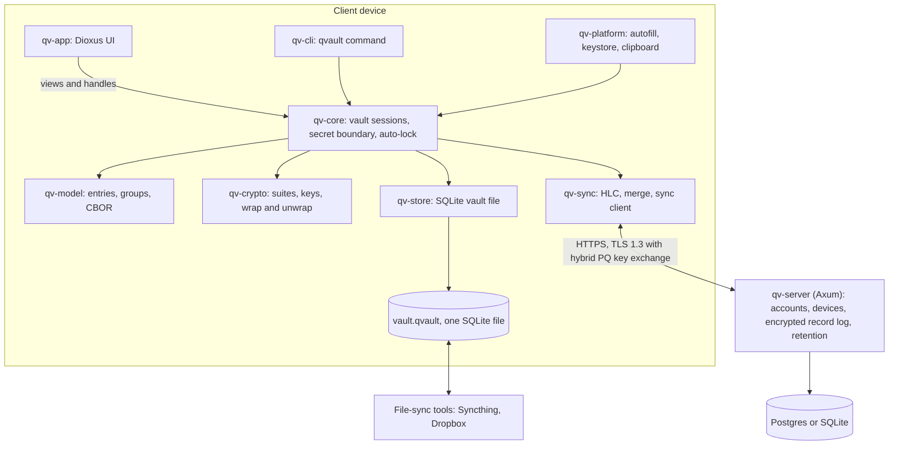
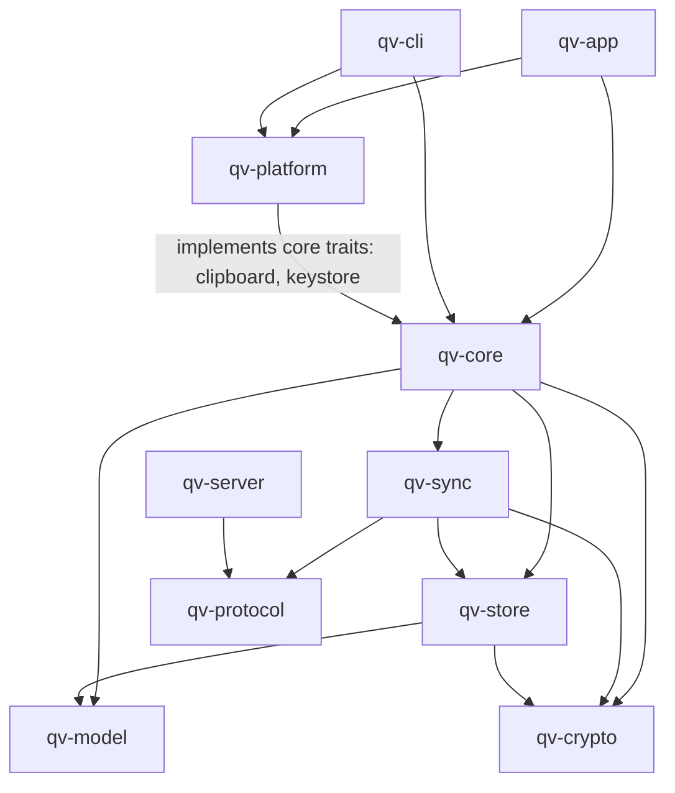

# QuickVault Architecture

QuickVault is an offline-first, end-to-end encrypted password manager with
optional synchronization. This document gives the high-level picture. The
normative details live in [`specs/`](specs/README.md); when this document and a
spec disagree, the spec wins.

## 1. Goals

| # | Goal | Primary spec |
|---|------|--------------|
| G1 | Store any kind of secret data, organised in nested groups (KeePassXC-like) | [0003](specs/0003-data-model.md) |
| G2 | Fully functional offline; sync is optional | [0004](specs/0004-local-storage.md), [0005](specs/0005-synchronization.md) |
| G3 | Desktop (Linux, Windows, macOS, maybe BSD), mobile (Android, iOS) and CLI clients | [0009](specs/0009-clients-and-platforms.md) |
| G4 | State-of-the-art, upgradable cryptography, hybrid post-quantum where asymmetric crypto is used | [0002](specs/0002-cryptography.md) |
| G5 | Zero-knowledge server: it never learns secrets or keys | [0005](specs/0005-synchronization.md), [0006](specs/0006-server-authentication.md) |
| G6 | Side-channel awareness (memory, timing, clipboard, screen, OS leaks) | [0008](specs/0008-memory-and-side-channels.md) |
| G7 | Recoverable history: undo deletions and bad syncs | [0007](specs/0007-history-and-backups.md) |
| G8 | Multi-user, multi-vault server, self-hosted or hosted | [0006](specs/0006-server-authentication.md) |
| G9 | Strong, unbiased password and passphrase generation | [0010](specs/0010-password-generator.md) |
| G10 | Scriptable CLI as the first client | [0011](specs/0011-cli.md) |

**Non-goals (v1):** sharing vaults between users, browser extension,
auto-type, key files, hardware tokens. The design must not *preclude* them.

## 2. Guiding principles

1. **The server is untrusted storage.** It sees only random IDs, ciphertext,
   sizes and timing. Everything else is encrypted client-side.
2. **The vault file is self-contained.** A vault is one SQLite file that can be
   copied, backed up or synced by any file-sync tool, and opened with only the
   master password.
3. **Crypto agility through versioned suites.** Every ciphertext and every
   key-derivation record carries a suite identifier. Algorithms and parameters
   are fixed *per suite*, and upgrading means introducing a new suite and
   migrating, never silently changing an existing one.
4. **Hybrid asymmetric crypto.** Wherever a public-key primitive is used, it is
   a classical + post-quantum hybrid (e.g. X25519 + ML-KEM-768). Symmetric
   primitives with 256-bit keys are already considered PQ-safe.
5. **Secrets live in Rust, behind one boundary.** Decrypted secret values stay
   inside `qv-core`; frontends work with handles and request plaintext
   explicitly (see §5).
6. **One merge algorithm everywhere.** Server sync, file-based sync and
   importing an old backup all reduce to merging two sets of versioned records.
7. **Audited building blocks only.** RustCrypto / well-reviewed crates, no
   home-grown primitives, `#![forbid(unsafe_code)]` everywhere except one small
   reviewed module for memory locking.

## 3. System overview



## 4. Repository layout

A single Cargo workspace:

```
quickvault/
├── ARCHITECTURE.md
├── specs/                 # RFC-style specifications (normative)
├── crates/
│   ├── qv-crypto/         # primitives, suites, key hierarchy, padding
│   ├── qv-model/          # plaintext data model + CBOR (de)serialization
│   ├── qv-store/          # SQLite vault file: schema, migrations, history
│   ├── qv-protocol/       # sync/auth wire types shared by client and server
│   ├── qv-sync/           # HLC, record merge, sync client
│   ├── qv-core/           # vault sessions, secret handles, locking policy
│   ├── qv-platform/       # keystore/biometrics, clipboard, autofill glue
│   ├── qv-server/         # Axum sync server
│   ├── qv-cli/            # command-line client (`qvault`)
│   └── qv-app/            # Dioxus desktop + mobile application
└── platform/
    ├── android/           # minimal autofill-service stub (if Rust/JNI can't host it alone)
    └── ios/               # credential-provider extension target
```

Crate dependencies (an arrow means "depends on"):



Rules:
- Dependencies point downward only. `qv-crypto` and `qv-model` depend on
  nothing internal.
- `qv-core` defines traits for OS services (clipboard, keystore); frontends
  inject the `qv-platform` implementations. This avoids a cycle between core
  and platform.
- `qv-server` depends only on `qv-protocol`. It has no access to `qv-crypto`
  key handling and could not decrypt anything anyway.

## 5. The secret boundary

Dioxus desktop and mobile render through a webview. Anything handed to the UI
becomes a JavaScript string that Rust cannot zeroize or lock in memory.
Therefore (proposal, see [0008 §4](specs/0008-memory-and-side-channels.md)):

- `qv-core` exposes **handles** (`EntryId`, `FieldId`) and non-secret metadata
  (titles, URLs, usernames are configurable as non-protected).
- Protected values are given to the UI only on explicit **reveal**, and are
  never placed there for copy/autofill: copy goes Rust → OS clipboard directly.
- A future native renderer (Dioxus Blitz) could remove the webview from the
  picture; the boundary keeps that switch cheap.

This is an **open design area** and must be revisited before the UI is built.

## 6. Key hierarchy (summary)

Master password → Argon2id → KEK → unwraps the **Vault Key (VK)**, a random
256-bit key. The **recovery phrase is VK itself** in BIP-39 word form. Every
other key is derived from VK with HKDF, down to one key per record. Changing
the master password re-wraps VK only. Losing the master password *and* the
recovery phrase means the data is gone, by design. Diagram and details:
[0002 §3](specs/0002-cryptography.md).

## 7. Main flows

**Unlock.** Read header → enforce suite minimums → Argon2id → KEK → unwrap VK
→ verify header MAC → decrypt records into the in-memory index.

**Edit.** Mutation in `qv-core` → new record version (fresh nonce, new HLC
timestamp) → previous version moved to history → written in one SQLite
transaction.

**Sync (server).** Pull remote versions since the cursor, three-way merge per
field (on a real conflict the newer value wins and the other is kept in
history), check the vault state commitment, push local versions, advance
cursors. The server only appends and serves ciphertext.

**Sync (file).** When the vault file was changed externally or a file-sync
conflict copy appears, open both and run the same merge.

**New device.** An enrolled device approves it through a QR code and hands
it VK inside a hybrid (X25519 + ML-KEM-768) encapsulation. With every device
lost, the recovery phrase proves ownership instead. The server never holds
anything that can be brute-forced.

### Diagram index

| Flow | Where |
|------|-------|
| System overview, crate dependencies | this document, §3–4 |
| Key hierarchy | [0002 §3](specs/0002-cryptography.md) |
| Unlocking a vault | [0002 §8](specs/0002-cryptography.md) |
| Vault file tables | [0004 §2](specs/0004-local-storage.md) |
| Saving an edit | [0004 §5](specs/0004-local-storage.md) |
| Three-way field merge | [0005 §2.6](specs/0005-synchronization.md) |
| Sync round | [0005 §3.2](specs/0005-synchronization.md) |
| Rollback and freeze detection | [0005 §5](specs/0005-synchronization.md) |
| **Registration** | [0006 §Registration](specs/0006-server-authentication.md#registration) |
| Uploading a vault | [0006 §Uploading a vault](specs/0006-server-authentication.md#uploading-a-vault) |
| **Login**: device session, account login | [0006 §Logging in](specs/0006-server-authentication.md#logging-in) |
| Adding a device | [0006 §Adding a device](specs/0006-server-authentication.md#adding-a-device) |
| Recovery with all devices lost | [0006 §Recovery](specs/0006-server-authentication.md#recovery-all-devices-lost) |
| Master password change | [0006 §Master password changes](specs/0006-server-authentication.md#master-password-changes) |
| Session lifecycle | [0006 §Sessions and expiry](specs/0006-server-authentication.md#sessions-and-expiry) |
| Secret boundary (copy and reveal) | [0008 §4](specs/0008-memory-and-side-channels.md) |

## 8. Technology choices

| Concern | Choice | Notes |
|---|---|---|
| Language | Rust (stable) | |
| UI | Dioxus (desktop + mobile) | webview caveat, §5 |
| Server | Axum + Tokio | |
| Server DB | sqlx with Postgres (hosted) / SQLite (small self-hosted) | open question |
| Local storage | SQLite via rusqlite, app-level encrypted rows | no SQLCipher |
| Serialization | CBOR (integer keys) | forward-compatible fields |
| AEAD | XChaCha20-Poly1305 | |
| Password KDF | Argon2id | parameters per suite |
| Subkey KDF | HKDF-SHA-512 | |
| KEM | X-Wing (X25519 + ML-KEM-768) | hybrid |
| Signatures | Ed25519 + ML-DSA-65 (hybrid) | device identities |
| Transport | TLS 1.3 (rustls), `X25519MLKEM768` group | |
| CLI | clap | |
| License | AGPL-3.0-or-later | |

## 9. Platform priority

1. Linux (desktop + CLI)
2. Android
3. Windows
4. iOS
5. macOS
6. BSDs (evaluate later)

## 10. Roadmap (proposal)

Deliver in thin, usable slices; each phase is useful on its own.

| Phase | Deliverable |
|-------|-------------|
| 1 | `qv-crypto`, `qv-model`, `qv-store`, `qv-core` + **CLI on Linux**: fully offline vault, history, recovery phrase |
| 2 | **Desktop app on Linux** (Dioxus), secret boundary, clipboard, auto-lock; file-based sync merge |
| 3 | **Server + sync**: username/password (OPAQUE), device enrollment, server identity, `closed` registration |
| 4 | **Android app**: quick unlock, then autofill |
| 5 | **Windows** |
| Later | Import/export, `invite` mode, hosted service (`open` mode), iOS, macOS, browser extension, BSDs |

## 11. Open questions (cross-cutting)

Each spec lists its own; these affect the overall shape:

1. **Secret boundary vs. webview** — is handle-and-reveal enough? (0008)
2. ~~Server authentication model~~ — decided: signed device enrollment +
   OPAQUE account password; `closed` registration by default. (0006)
3. ~~Account credential vs. vault password~~ — decided: separate secrets. (0006)
4. **Snapshot retention** — periodic, fixed count, or tiered. (0007)
5. **Mobile autofill packaging** — how much can be pure Rust (JNI / static lib)
   and how thin the platform glue can be. (0009)
6. ~~Rollback/freeze protection~~ — decided: per-record HLC + authenticated
   vault state commitment; new devices can't fully verify. (0005)
