<div align="center">

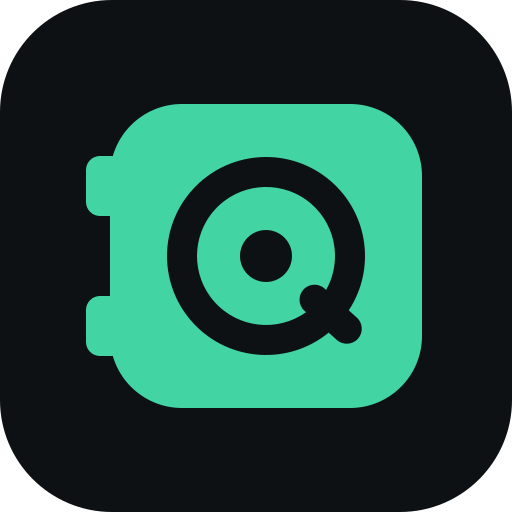

# QuickVault

**An offline-first, end-to-end encrypted password manager.**<br>
No account, no server and no Internet connection required. Sync is optional and explicit.

[](https://github.com/rdbo/quickvault/actions/workflows/ci.yml)
[](LICENSE)
[](rust-toolchain.toml)


<br>

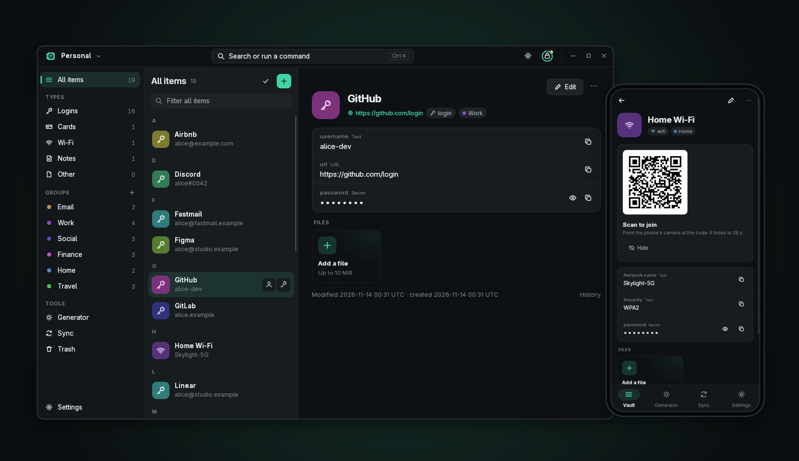

</div>

> [!WARNING]
> QuickVault is **pre-1.0 and under active development**. File and wire
> formats may still change, and the code has not been independently audited.
> Don't keep your only copy of important secrets in it yet.

## Contents

- [Why QuickVault](#why-quickvault)
- [Features](#features)
- [Screenshots](#screenshots)
- [Getting started](#getting-started)
- [Command-line client](#command-line-client)
- [Syncing between devices](#syncing-between-devices)
- [Security design](#security-design)
- [Architecture](#architecture)
- [Project status](#project-status)
- [Contributing](#contributing)
- [License](#license)

## Why QuickVault

Most password managers assume an account and a cloud. QuickVault starts
from the other end: a complete vault is a single encrypted file on your
device, and everything works with the network unplugged. When you want your
secrets on another device, you sync **directly over your local network** by
scanning a one-use QR code. No account, no relay and nothing stored about
the other device. A self-hosted remote-sync server was designed (as untrusted storage
that only ever sees ciphertext) but is not planned for now.

- **Offline is the default, not a fallback.** Reads and edits never wait
  for the network, and nothing depends on an account or a server.
- **One UI everywhere.** The same app runs on Linux, Android and Windows
  and adapts from a three-pane desktop layout down to a phone.
- **Edits are never silently lost.** Concurrent edits from different
  devices are kept whole and shown as conflicts for you to resolve, and
  every change is kept in history.
- **Specs first.** Behaviour is defined in [normative specifications](specs/README.md)
  before it's implemented, including the threat model.

## Features

| | |
|---|---|
| 🔐 **Encrypted vault** | One SQLite file of encrypted objects. Argon2id key derivation, XChaCha20-Poly1305, an authenticated manifest and rollback anchors. |
| 🗂️ **Organize** | Nested groups; logins, secure notes, cards, Wi-Fi networks and custom items; custom fields; colors; fast full search over non-secret fields. |
| 📎 **Attachments** | Files stored in encrypted, padded 64 KiB chunks, with in-memory previews for images and media. |
| ⏱️ **TOTP** | Built-in one-time codes for two-factor logins. |
| 🎲 **Generator** | Random passwords and word passphrases with strength estimates. |
| 🕓 **History & recovery** | Every edit kept in history; trash; local snapshots; 24-word recovery phrase; key rotation; a full `verify` pass. |
| 🔄 **LAN sync** | Peer-to-peer over the local network with one-use QR or typed codes. Post-quantum hybrid key exchange (X-Wing). |
| ⚖️ **Conflicts** | Causal, whole-record merging. Concurrent versions stay intact until you pick one. |
| 📦 **Archives** | Authenticated encrypted archives for backups, or for exchanging a vault through Syncthing, Dropbox or a USB stick. |
| 📱 **Android** | Fingerprint quick unlock backed by hardware keys, exact-match autofill, in-app QR scanner, `FLAG_SECURE`. |
| 🧹 **Secret hygiene** | Secrets held in zeroizing containers, clipboard cleared after 20 s, reveal times out after 30 s, auto-lock after 60 s idle or on screen lock. |
| ⌨️ **CLI** | `qv`, a full scriptable client for the same vaults, with JSON output. |

## Screenshots

<p align="center">
  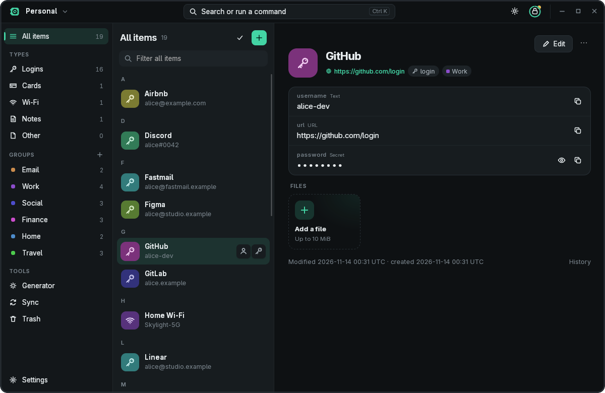
  <br>
  <em>Sidebar, item list and item details under QuickVault's own title bar.</em>
</p>

<table>
  <tr>
    <td width="50%">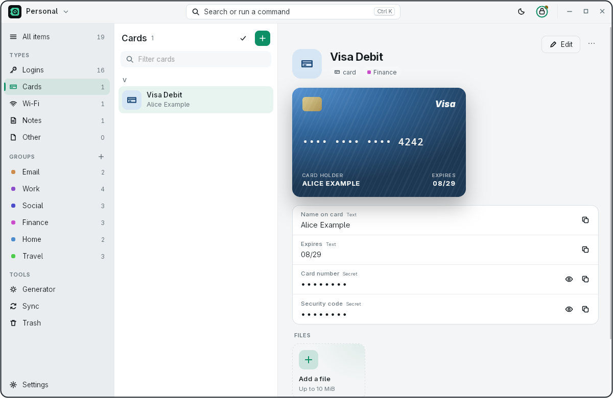</td>
    <td width="50%">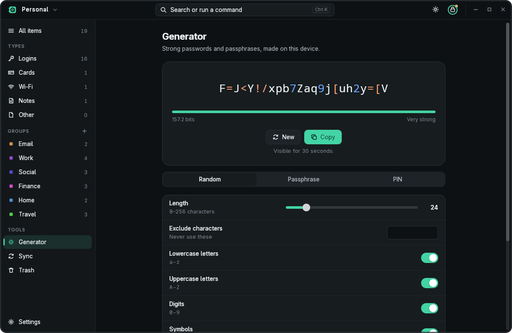</td>
  </tr>
  <tr>
    <td align="center"><em>Light theme, card item</em></td>
    <td align="center"><em>Password generator</em></td>
  </tr>
  <tr>
    <td width="50%">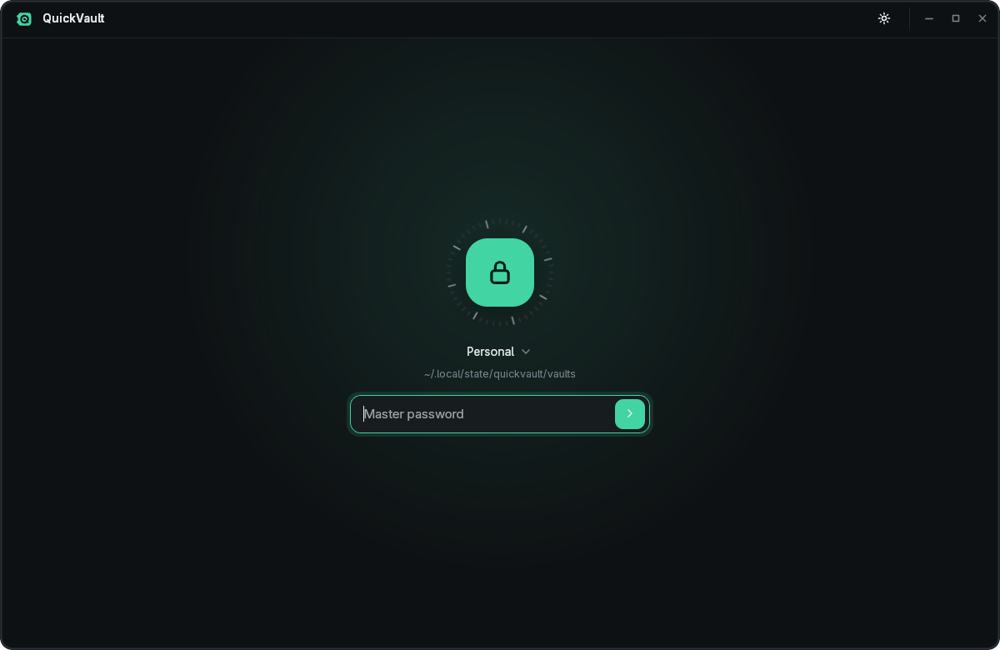</td>
    <td width="50%">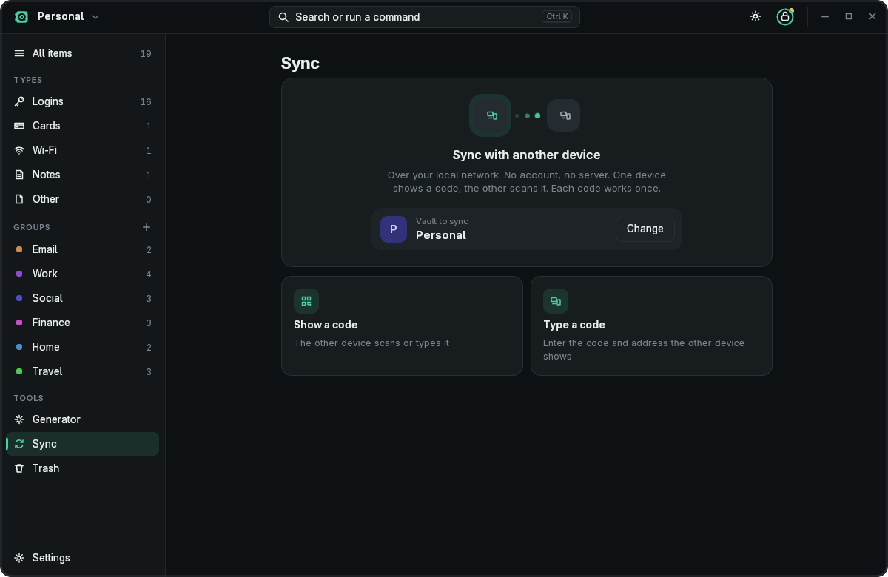</td>
  </tr>
  <tr>
    <td align="center"><em>Lock screen</em></td>
    <td align="center"><em>LAN sync: no account, no server</em></td>
  </tr>
</table>

<p align="center">
  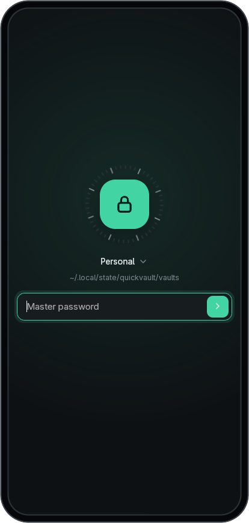
  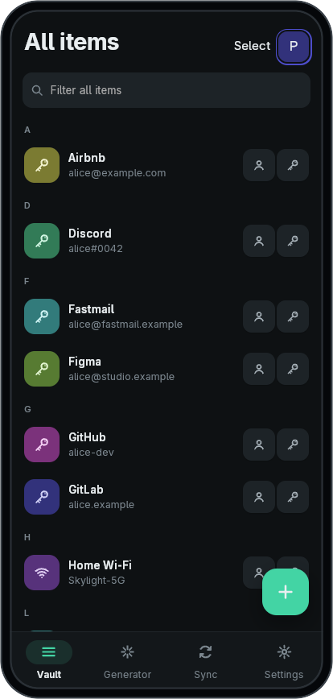
  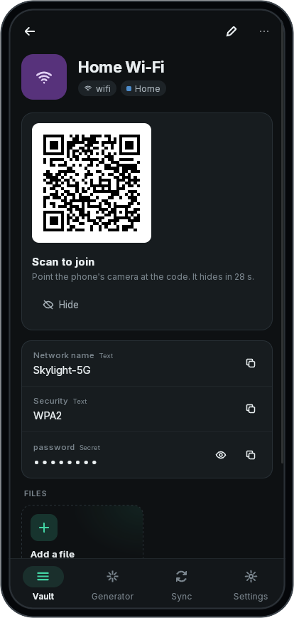
  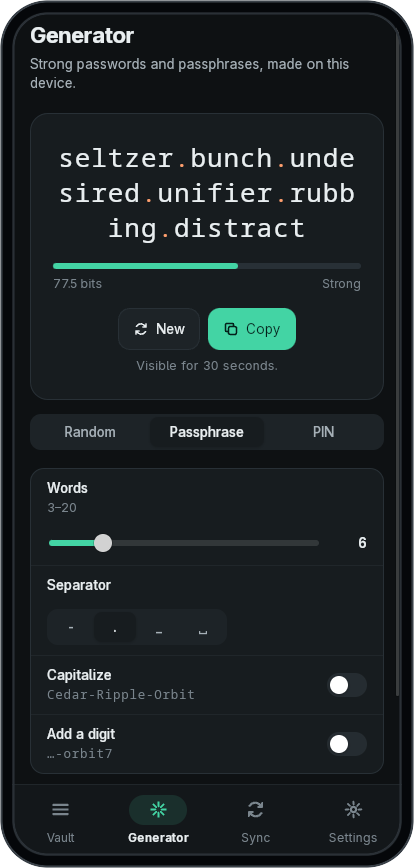
  <br>
  <em>The same UI at phone width, with bottom tabs. Wi-Fi items show a QR code other phones can scan to join.</em>
</p>

All screenshots show a throwaway demo vault filled with made-up data.

## Getting started

QuickVault is built from source for now; there are no release packages yet.

### Prerequisites

- [Rust](https://rustup.rs/). The toolchain is pinned in
  [`rust-toolchain.toml`](rust-toolchain.toml) (1.98.1) and `rustup` picks it
  up automatically.
- **Linux desktop app:** GTK 3, WebKitGTK 4.1, libxdo and the AppIndicator
  development libraries. For example, on Debian or Ubuntu:

  ```sh
  sudo apt install libgtk-3-dev libwebkit2gtk-4.1-dev libxdo-dev libayatana-appindicator3-dev
  ```

### Build and run

```sh
git clone https://github.com/rdbo/quickvault.git
cd quickvault

# Desktop app (Linux; Windows uses WebView2)
cargo run --locked --release -p qv-app --features desktop --bin quickvault

# Command-line client
cargo install --locked --path crates/qv-cli   # installs `qv`
```

Create a vault from the welcome screen by giving it a name and a master
password. The app then shows your 24-word recovery phrase. Write it down:
it's the only way back in if you forget the master password.

Vaults are stored in `~/.local/share/quickvault/vaults` and private app
state in `$XDG_STATE_HOME/quickvault` (`%LOCALAPPDATA%\QuickVault` on
Windows).

### Android

Android (arm64, API 29+) builds use a pinned SDK/NDK recipe, JDK 21 and the
Dioxus CLI 0.7.10:

```sh
sh scripts/setup-android.sh --accept-licenses
eval "$(sh scripts/setup-android.sh --print-env)"
sh crates/qv-app/scripts/build-android.sh   # APKs land in crates/qv-app/dist/
```

See [`crates/qv-app/README.md`](crates/qv-app/README.md) for platform details,
quick unlock, autofill and the validation tooling.

## Command-line client

`qv` works on the same vault files as the app. Secrets are never taken as
arguments or environment variables: they're prompted for without echo,
generated, or (for the master password only) read with `--password-stdin`.

```console
$ qv init ~/vaults/personal.qvault --name Personal
$ export QVAULT_PATH=~/vaults/personal.qvault

$ qv add Email/Proton --username alice@example.com --url https://proton.me --generate
$ qv ls -r
$ qv search proton
$ qv show Email/Proton
$ qv copy Email/Proton              # copied; cleared after 20 seconds
$ qv totp Email/Proton

$ qv history Email/Proton
$ qv snapshot ls
$ qv verify
```

Run `qv --help` or `qv <command> --help` for everything else: groups, trash,
attachments, conflicts, archive export and merge, password change, recovery
and key rotation. The full reference is [spec 0011](specs/0011-cli.md).

## Syncing between devices

Sync is always something you start; nothing happens in the background.

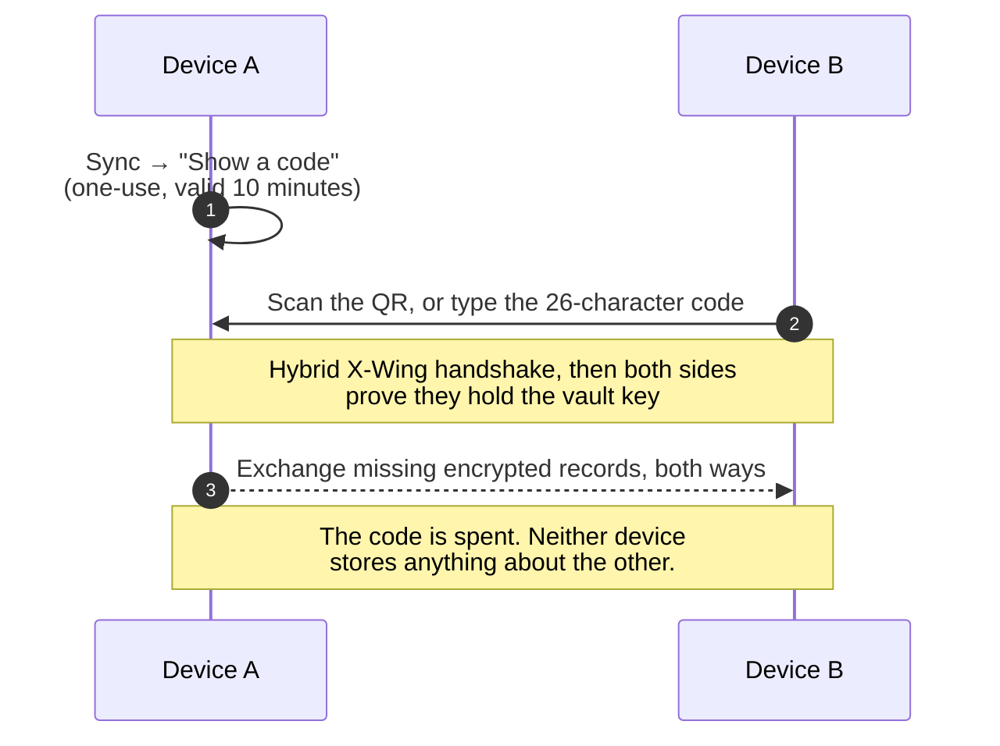

- **Sync** two copies of the same vault: `qv lan open` on one device,
  `qv lan sync` on the other, or **Show a code** / **Scan a code** in the app.
- **Add a new device** with `qv lan join --new`, or **Join from another
  device** on the app's lock screen. The new device proves itself with the
  vault password (both screens show a comparison code) or with the recovery
  words.
- **Without a network,** export an encrypted archive and merge it on the
  other device. Archives open only with the vault key and are authenticated
  before anything parses them.

## Security design

QuickVault's [threat model](specs/0001-threat-model.md) assumes stolen vault
files, hostile networks, malicious sync peers and an untrusted server. In
brief:

- **Key hierarchy.** Your master password (Argon2id) or recovery phrase
  unwraps a random vault key. Key derivation, data encryption, wrapping and
  signature profiles are versioned independently, so each can evolve
  without migrating the others ([spec 0002](specs/0002-cryptography.md)).
- **Authenticate before parsing.** Every record, manifest and archive is
  authenticated before it's decoded. Untrusted input is size-bounded before
  allocation, and attacker-supplied files never reach the SQLite parser
  ([spec 0004](specs/0004-local-storage.md)).
- **Rollback detection.** An authenticated manifest covers every live version,
  retained history and tombstone, and a per-device anchor detects a vault
  file that has been swapped for an older copy.
- **Post-quantum ready.** LAN sync uses X-Wing (X25519 + ML-KEM-768).
  The (not planned) remote-sync design adds Ed25519 + ML-DSA-65 signatures
  and hybrid TLS.
- **Memory hygiene.** Application secrets live in zeroizing containers,
  are never logged or put in error messages, and core dumps are disabled.
  Webview and OS copies are cleaned up on a best-effort basis, and the
  limits are documented ([spec 0008](specs/0008-memory-and-side-channels.md)).
- **No home-made cryptography.** Only reviewed crates, pinned exactly.
  Dependencies are checked with `cargo deny` and `cargo vet`, and decoders
  are fuzzed weekly in CI.

> [!NOTE]
> A written spec or a passing test suite doesn't prove that something is
> secure. The release gates in
> [spec 0012](specs/0012-security-validation.md), including independent
> review of the sync protocols, are still open.

## Architecture

QuickVault is a Cargo workspace of small crates. Frontends talk only to
`qv-core`, and the cryptography and data model never depend on a frontend.

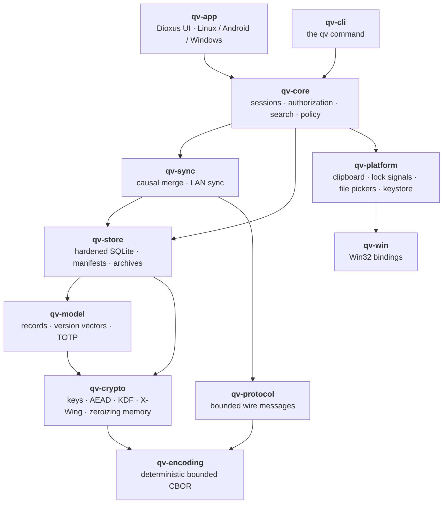

| Crate | Role |
|-------|------|
| [`qv-encoding`](crates/qv-encoding) | Bounded, deterministic CBOR; validates hostile input before typed reads |
| [`qv-crypto`](crates/qv-crypto) | Crypto profiles, key hierarchy, protected memory, password generator, LAN handshake keys |
| [`qv-model`](crates/qv-model) | Records and payloads, version vectors, merge, group tree, TOTP |
| [`qv-store`](crates/qv-store) | The hardened vault file, encrypted objects, manifests, anchors, archives, `verify` |
| [`qv-protocol`](crates/qv-protocol) | Key-free LAN wire format: frames, messages, QR and code formats |
| [`qv-sync`](crates/qv-sync) | Causal merge candidates and the LAN sync exchange over TCP |
| [`qv-core`](crates/qv-core) | Sessions, locking, mutation authorization, search index, snapshots, sync windows |
| [`qv-platform`](crates/qv-platform) | OS adapters: clipboard, lock/sleep signals, file pickers, Android keystore |
| [`qv-win`](crates/qv-win) | Windows-only Win32 FFI; the only crate allowed `unsafe` |
| [`qv-cli`](crates/qv-cli) | The `qv` command-line client |
| [`qv-app`](crates/qv-app) | The shared Dioxus app for desktop and phone |

[`ARCHITECTURE.md`](ARCHITECTURE.md) covers trust boundaries, the key
lifecycle and the main flows in depth.

## Project status

| Phase | Scope | State |
|-------|-------|-------|
| 1 | Offline core, encrypted vault, history and recovery, Linux CLI | ✅ Done |
| 2 | Linux and Android apps, LAN sync, conflicts, archive exchange | 🚧 Implemented; device validation and owner review in progress |
| 3 | Windows | 🚧 Implemented; Windows gate evidence pending |
| 4 | Optional self-hosted server and remote sync | ⏸️ Not planned (design kept in the specs) |
| Later | Automatic sync, import/export from other managers, iOS/macOS, browser extension | 💭 Future |

The detailed roadmap is in [`plans/0002-roadmap`](plans/0002-roadmap/PLAN.md)
and changes are listed in [`CHANGELOG.md`](CHANGELOG.md). What remains before
1.0 (offline vault plus LAN sync on Linux, Android and Windows) is tracked in
[plan 0056](plans/0056-release-1-0/PLAN.md).

## Contributing

QuickVault is developed spec-first:

1. **Specs are normative.** A behaviour change starts as an amendment in
   [`specs/`](specs/README.md).
2. **Plans before code.** Non-trivial work gets a plan in [`plans/`](plans/README.md).
   Cryptography, storage or wire formats, protocols and secret handling go
   through design, implementation and an independent review.
3. **Every change passes the gates:**

   ```sh
   sh scripts/check-spdx.sh
   cargo fmt --check
   cargo clippy --all-targets --locked -- -D warnings
   cargo test --locked
   ```

   The app's UI code also needs `--features desktop` (or `validation`) for
   Clippy and tests. Dependency changes also run `cargo deny check` and
   `cargo vet --locked`.

Every source file starts with `// SPDX-License-Identifier: AGPL-3.0-or-later`.
`unsafe` is forbidden outside `qv-win`, and `unwrap`/`expect`/`panic!` are
denied outside tests. Read [`AGENTS.md`](AGENTS.md) for the full
contributor workflow.

## License

QuickVault is free software, licensed under the
[GNU Affero General Public License v3.0 or later](LICENSE).
The vendored `dioxus-desktop` fork under [`third-party/`](third-party/README.md)
keeps its upstream MIT/Apache-2.0 license.
