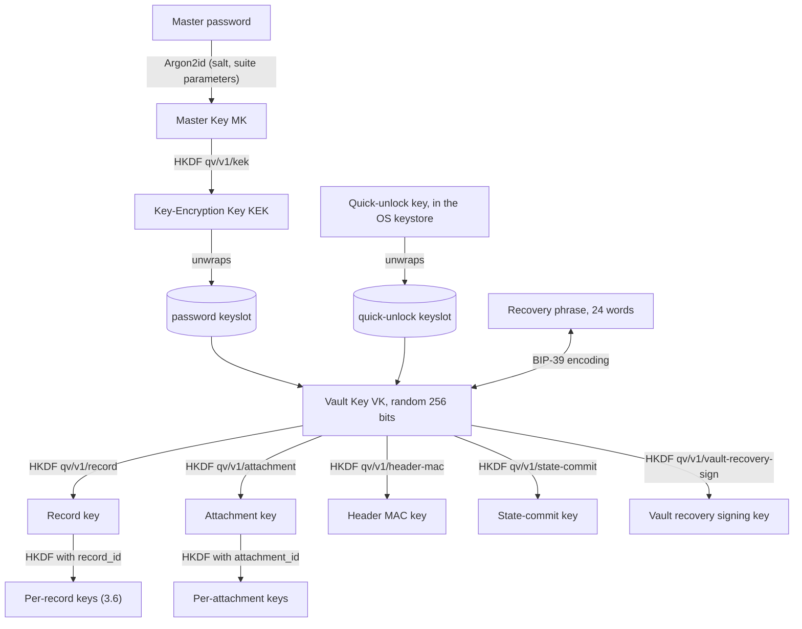
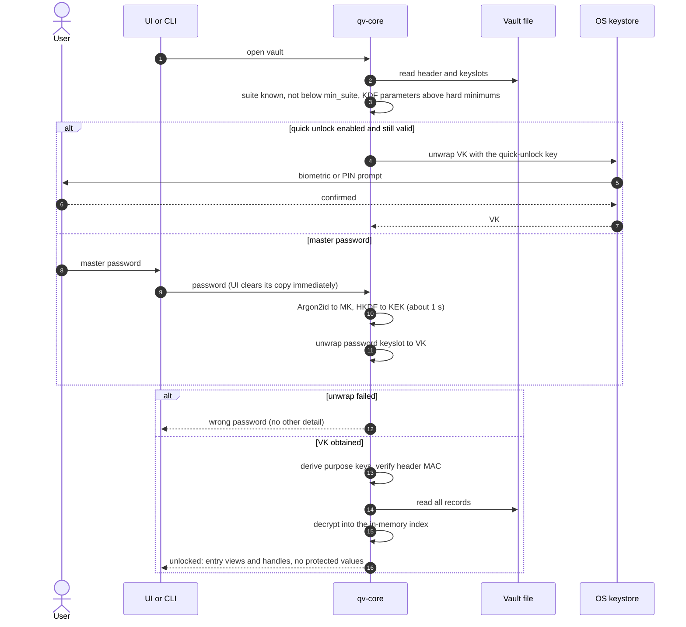

# 0002 — Cryptography and Key Hierarchy

| Status | Created | Depends on |
|--------|---------|------------|
| Accepted | 2026-10-14 | 0001 |

## Summary

Defines the primitives QuickVault uses, how they are grouped into versioned
**suites**, the key hierarchy from master password to per-purpose keys, the
recovery phrase, quick-unlock, and how algorithms or parameters are upgraded.

## Specification

### 1. Crypto suites

1.1. Every algorithm choice and parameter set is bound to a **suite
identifier** (`u16`). Every persisted ciphertext, wrapped key and KDF record
MUST carry the suite ID it was produced with.

1.2. Suites are immutable once released. Changing an algorithm *or a
parameter* (e.g. raising Argon2id memory) MUST be done by defining a new suite.

1.3. Clients MUST refuse suites they don't know and MUST refuse suites marked
as **retired** for writing. Retired suites MAY still be read for migration.

1.4. **Suite 1** (initial):

| Purpose | Primitive | Parameters |
|---------|-----------|------------|
| Password KDF | Argon2id (v1.3) | m = 256 MiB, t = 3, p = 4, 32-byte output, 32-byte random salt |
| AEAD | XChaCha20-Poly1305 | 256-bit key, 192-bit random nonce, 128-bit tag |
| Subkey derivation | HKDF-SHA-512 | `info` = domain-separation label (§3.3) |
| MAC | HMAC-SHA-512/256 (via HKDF-derived key) | |
| KEM | X-Wing (X25519 + ML-KEM-768) | see §6 |
| Signatures | Ed25519 + ML-DSA-65, both MUST verify | see §6 |
| Hash | SHA3-256 / SHA-512 | |
| CSPRNG | OS RNG (`getrandom`) | |

> Argon2id values above are a placeholder. Final values are chosen by
> benchmark in phase 1 against these **acceptance criteria**:
> - memory MUST NOT be below 64 MiB (RFC 9106 second recommended option);
>   higher is preferred, since memory is what makes GPU/ASIC attacks expensive;
> - one unlock SHOULD take about 1 s on a mid-range Android phone (≤ 2 s on
>   a low-end one), and therefore well under 1 s on a desktop;
> - within that time budget, prefer more memory over more passes.
>
> Rough attacker cost at these settings: each guess needs the full memory, so
> a high-end GPU manages on the order of tens to a few hundred guesses per
> second. A 5-word random passphrase (~64 bits) then takes far longer than
> any realistic attacker can spend.

### 2. Upgrade (migration) rules

2.1. When a client supporting a newer suite unlocks a vault on an older one,
it SHOULD offer to migrate. Migration of the password KDF only requires the
master password and re-wrapping VK (§3). Migration of the AEAD requires
re-encrypting every record and is done in one transaction.

2.2. A client MUST NOT downgrade a vault to an older suite.

2.3. The vault header (0004) stores the minimum suite a vault accepts. After
migration this minimum is raised so that a tampered header cannot reintroduce
weak parameters (downgrade attack, see §7).

### 3. Key hierarchy



3.1. **Master Key (MK):** Argon2id(password, salt, suite params). The
password MUST be normalised to Unicode NFC before hashing. MK is never stored.
Each vault has its **own master password** and its own salt; there is no
shared password across vaults.

3.2. **Vault Key (VK):** 32 random bytes generated at vault creation. Its
human-readable form is the **recovery phrase** (§4). VK is stored only in
**wrapped** form. Each unlock method produces one *keyslot*:

| Keyslot | Wrapping key |
|---------|--------------|
| `password` | KEK = HKDF(MK, "qv/v1/kek") |
| `quick-unlock:<device>` | device-bound key held in the OS keystore (§5) |

There is no recovery keyslot: the recovery phrase *is* VK (§4).

A keyslot is `AEAD(wrapping_key, nonce, VK, aad = vault_id ‖ slot_type ‖ suite_id)`.
Which keyslots may leave a device is defined in 0006 §Key custody: the
`password` keyslot leaves only inside the VK-encrypted keyslot record, so it
is never exposed to anyone without VK.

3.3. **Purpose keys** derived from VK with HKDF-SHA-512 and distinct labels:

| Label | Use |
|-------|-----|
| `qv/v1/record` | encrypting records (0004) |
| `qv/v1/attachment` | encrypting attachment chunks |
| `qv/v1/header-mac` | authenticating the vault header |
| `qv/v1/state-commit` | rollback-detection commitments (0005) |
| `qv/v1/vault-recovery-sign` | seed of the vault recovery signing key pair (0006 §Recovery) |

New purposes MUST use new labels; labels are never reused.

3.4. **Changing the master password** re-derives MK/KEK and replaces the
`password` keyslot. Records are not re-encrypted.

3.5. **VK rotation** (e.g. after suspected compromise or a leaked recovery
phrase) generates a new VK, and therefore a **new recovery phrase**, and
re-encrypts all records. It MUST invalidate all keyslots and require
re-enrollment of quick-unlock and devices.

3.6. **Per-record keys.** Each record is encrypted with its own key:

```
record_key(r) = HKDF-SHA-512(ikm = VK-derived "qv/v1/record" key,
                             salt = vault_id,
                             info = "qv/v1/record-key" ‖ record_id)
```

Attachment chunks use `info = "qv/v1/attachment-key" ‖ attachment_id`.

*Rationale:* defense in depth and containment. Each key encrypts only one
record's versions, so a hypothetical future weakness in the AEAD that needs
much ciphertext under one key gets very little. A key recovered from one
record says nothing about other records or VK, because HKDF is one-way.

*What this does not change:* knowing the plaintext of an entry (e.g. your
Google password) does **not** let an attacker recover the key or the master
password, even with a single vault-wide key. XChaCha20-Poly1305 is secure
against known-plaintext attacks, and VK is 256 random bits, not derived from
the password. The master password can only be attacked by guessing it through
Argon2id against a keyslot.

*Cost:* HKDF has no work-factor parameters and runs in microseconds. Argon2id
is only needed for low-entropy inputs (passwords). VK is already full-entropy,
so per-record derivation is free.

### 4. Recovery phrase

4.1. The recovery phrase is **VK itself**, encoded as a **24-word BIP-39
English mnemonic** (256 bits + 8-bit checksum), like a cryptocurrency wallet
seed. Phrase → VK is a pure decoding step; there is no extra key and no
Argon2 (VK is already full-entropy).

4.2. At vault creation the phrase is shown and the user MUST confirm it
(e.g. by re-entering selected words) or explicitly skip with a warning. It
MUST be stored extremely securely (offline, on paper or metal).

4.3. The phrase is never stored by QuickVault. While unlocked, a client MAY
show it again after the master password is re-entered (it can be re-encoded
from VK in memory), e.g. when the user has lost the paper copy.

4.4. Getting a *new* phrase means rotating VK (§3.5): all records are
re-encrypted. This is cheap for vault-sized data (seconds at most).

4.5. The phrase gives full access to the vault, without the master password.
It is the same asset as VK (0001 A4).

4.6. One phrase per vault; each vault has its own VK.

4.7. If both the master password and the recovery phrase are lost, the data is
**unrecoverable. This is intentional** (0001 SG8). The UI MUST say so plainly.

### 5. Quick unlock

5.1. Opt-in, per device. After a full unlock, the client generates a random
32-byte *quick-unlock key* (QK), creates a `quick-unlock:<device>` keyslot
wrapping VK under QK, and stores QK in the OS keystore protected by user
authentication (Android Keystore with `setUserAuthenticationRequired`,
StrongBox when available; Windows Hello; Secure Enclave; Linux: Secret Service
/ TPM — TBD).

5.2. QK MUST be non-exportable where the platform allows it (key never leaves
the keystore; the keystore performs the unwrap). Otherwise it MUST be released
only after biometric/PIN authentication.

5.3. The master password MUST be required again after: device reboot,
a configurable maximum age (default 7 days), N failed quick-unlock attempts
(default 3), or a master-password change.

5.4. Quick-unlock keyslots are local to the device and MUST NOT be synced.

### 6. Hybrid asymmetric cryptography

6.1. Asymmetric crypto is used only for device enrollment and key transport
between devices (0006), not for vault data at rest.

6.2. **KEM:** X-Wing (draft-connolly-cfrg-xwing-kem), which combines X25519
and ML-KEM-768 as
`ss = SHA3-256(label ‖ ss_MLKEM ‖ ss_X25519 ‖ ct_X25519 ‖ pk_X25519)`.

*Rationale:* this is the "do both, hash the secrets together" design, but in a
reviewed form. Hashing in the X25519 ciphertext and public key binds the shared
secret to this specific exchange; just hashing the two shared secrets is not
provably secure for every KEM combination.

6.3. **Signatures:** a hybrid signature is the pair (Ed25519 sig, ML-DSA-65
sig) over the same message with a domain-separation prefix; verification MUST
require both to be valid.

6.4. **Transport:** TLS 1.3 SHOULD negotiate the `X25519MLKEM768` hybrid
group. QuickVault's security MUST NOT depend on TLS for confidentiality of
vault data (it is already end-to-end encrypted). TLS protects only metadata
and authentication exchanges.

### 7. General rules

7.1. Nonces for XChaCha20-Poly1305 MUST be 24 random bytes from the CSPRNG; nonce
reuse under the same key is forbidden. Random nonces are safe here because
the 192-bit space makes collisions negligible.

7.2. All AEAD operations MUST bind context through associated data (vault ID,
record ID, version, suite ID, purpose) so ciphertexts cannot be moved between
records, vaults or purposes.

7.3. The vault header (KDF params, salt, keyslots, minimum suite) MUST be
authenticated with the header-MAC key **after** VK is unwrapped. The client
MUST also enforce hard minimum KDF parameters from its own code *before*
running the KDF, so a tampered header cannot weaken it.

7.4. All comparisons of secrets, MACs and tags MUST be constant-time (`subtle`).

7.5. Implementations MUST use RustCrypto (or equally audited) crates:
`argon2`, `chacha20poly1305`, `hkdf`, `sha2`, `sha3`, `x25519-dalek`,
`ed25519-dalek`, `ml-kem`, `ml-dsa`, `zeroize`, `subtle`. No custom primitives.

### 8. Unlock flow

8.1. Unlocking is fully local; no network is involved.

8.2. Parameter checks (suite and KDF minimums) MUST happen **before** running
Argon2id, and the header MAC MUST be verified **after** VK is obtained and
before any record is trusted (§7.3).

8.3. A failed unlock reports only "wrong password" and never which step
failed.



## Security Considerations

- Parameters fixed per suite (rather than calibrated per device) give the same
  offline-attack cost everywhere, at the price of slower unlocks on weak
  devices. Quick-unlock offsets the UX cost.
- ML-KEM / ML-DSA are newer and less battle-tested; the hybrid constructions
  ensure that breaking one half alone is not enough (0001 SG6).
- The recovery phrase is a second master key. Its security is equal to that
  of where the user stores it.

## Open Questions

1. Final Argon2id parameters for suite 1 (benchmark per the acceptance
   criteria in §1.4). The iOS AutoFill extension has a ~120 MB memory limit:
   if quick-unlock has expired there, it hands off to the main app for a full
   unlock rather than lowering parameters for everyone.
2. Linux quick-unlock backend: Secret Service, TPM2, or both?
3. Should the recovery phrase support an optional extra passphrase (BIP-39
   "25th word")?
4. HKDF-SHA-512 vs. BLAKE3 `derive_key` for subkeys. HKDF is chosen for being
   conservative; revisit only if needed for performance.
5. Per-record keys: derived (§3.6, no storage, can't be revoked
   individually) vs. random per-record keys wrapped by VK (+72 bytes per
   record). Random keys would allow sharing one entry with another user, and
   making an entry's history unreadable by destroying its key. Derived is
   chosen for v1; revisit when sharing is designed.

## Changelog

- 2026-10-14: Initial draft.
- 2026-10-14: Added per-record key derivation (§3.6).
- 2026-10-14: Recovery phrase is VK itself (BIP-39 encoding); removed the
  recovery keyslot.
- 2026-10-14: One master password per vault; Argon2id acceptance criteria.
  Status → Accepted (Argon2id values pending benchmark).
- 2026-10-14: Key hierarchy as a Mermaid diagram; added the
  `qv/v1/vault-recovery-sign` label; unlock flow (§8). Amendment, no
  behaviour change beyond the new label.
