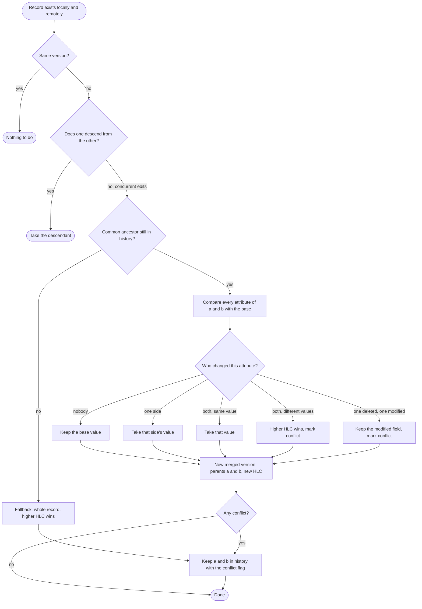
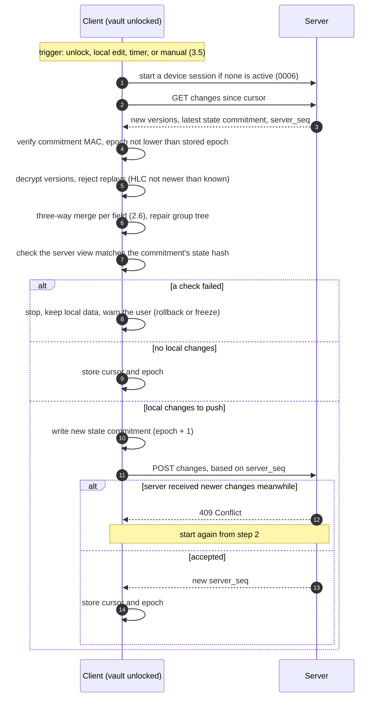
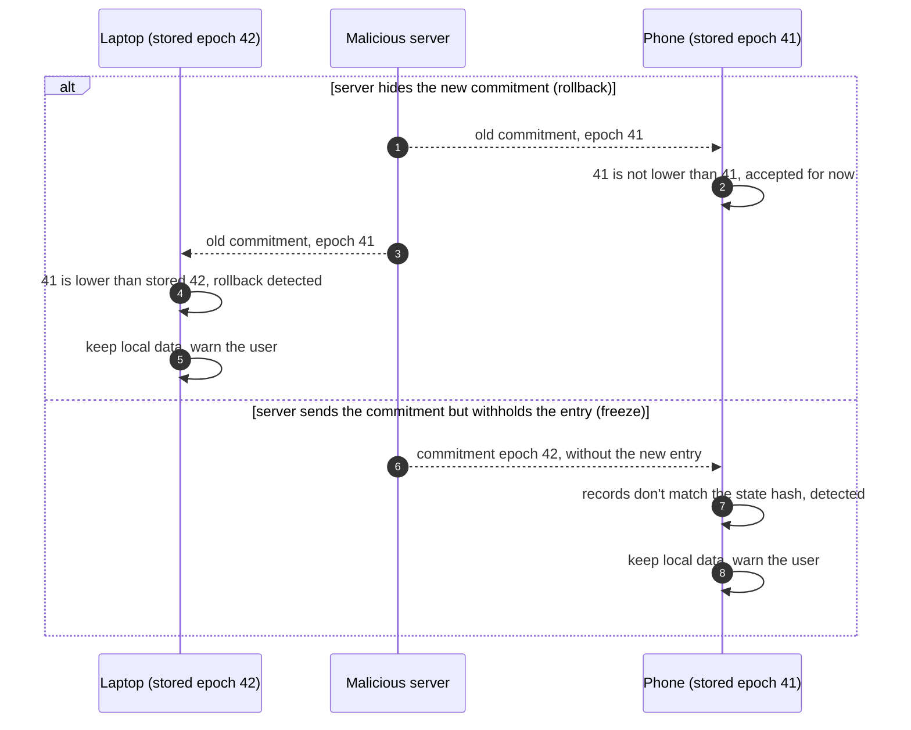

# 0005 — Synchronization and Conflict Resolution

| Status | Created | Depends on |
|--------|---------|------------|
| Draft | 2026-10-14 | 0002, 0003, 0004 |

## Summary

Synchronization works on encrypted, versioned records. A single merge
algorithm is used for server sync, file-based sync (Syncthing, Dropbox…) and
restoring backups. Newer edits win per record; the losing version is always
kept in history.

## Specification

### 1. Versioning: Hybrid Logical Clocks

1.1. Every record version carries an **HLC timestamp** `(wall_ms, counter)`
and the writing `device_id`, both inside the encrypted envelope (0004 §3.1).

1.2. HLCs give "newest wins" semantics that follow real time when clocks are
correct, but never go backwards when clocks drift: a device that receives a
version with a higher HLC advances its own clock past it.

1.3. Ordering: `(hlc.wall_ms, hlc.counter, device_id)` — `device_id` is a
deterministic tiebreak, so all devices pick the same winner.

1.4. A client MUST reject a remote `wall_ms` more than 24 h in the future
(protects against a bad clock "winning" every merge forever) and surface a
warning.

### 2. Merge algorithm

For each record ID present on either side:

| Local | Remote | Result |
|-------|--------|--------|
| v | — | keep v (push it) |
| — | v | take v |
| a | b, a == b | nothing |
| a | b, b descends from a | take b |
| a | b, concurrent | **three-way field merge** (§2.6) |

2.1. "Descends from" is decided via `prev_version_hash` (hash of the parent
version's ciphertext) in the envelope.

2.2. Conflicts MUST be visible: the UI shows a "resolved conflict" marker on
the entry, and the user can restore the losing version in one action.

2.3. Deletions are versions with `deleted = true` (tombstones) and take part in
merge like any other version. Tombstones are purged according to 0007.

2.4. After merging, the client repairs the group tree (0003 §4.1–4.2).

2.5. Merge MUST be deterministic and commutative: two devices that merged
the same sets of versions end up with identical current state.

2.6. **Three-way field merge.** For concurrent versions `a` and `b`:

1. Find the **base**: their nearest common ancestor, by following
   `prev_version_hash` through `record_history`.
2. Compare each *attribute* of `a` and `b` against the base. Attributes are:
   every field (matched by field `id`, 0003 §5) plus each top-level property
   (`title`, `notes`, `group`, `icon`, `expires_at`, `deleted_at`, `type_hint`,
   and the equivalents for groups).
3. Per attribute:

   | Changed in `a` | Changed in `b` | Result |
   |---|---|---|
   | no | no | base value |
   | yes | no | `a`'s value |
   | no | yes | `b`'s value |
   | yes | yes, same value | that value |
   | yes | yes, different | **conflict:** value from the version with the higher HLC |

4. A field deleted on one side and modified on the other is **kept**
   (modified value) and counts as a conflict, so no data disappears silently.
5. Field order: the order of the version with the higher HLC, followed by
   fields only present on the other side.
6. The result is a new version whose parents are `a` and `b`
   (`prev_version_hash` becomes a list) with a new HLC.
7. If at least one attribute conflicted, both `a` and `b` are kept in
   `record_history` with the `conflict` flag (2.2).
8. **No base available** (history pruned, e.g. a device offline for a long
   time): fall back to whole-record "higher HLC wins", loser kept with the
   `conflict` flag.

The same algorithm applies to groups and vault metadata.

### 3. Server sync protocol (outline)

3.1. The server stores per vault an **append-only log** of
`(server_seq, record_id, ciphertext)`; `server_seq` is a per-vault
monotonically increasing integer assigned by the server.

3.2. Sync round:
1. `GET /vaults/{id}/changes?since={cursor}` → versions with `server_seq > cursor`.
2. Client verifies, decrypts and merges them locally, and checks the state
   commitment (§5).
3. `POST /vaults/{id}/changes` with local versions not yet pushed, along with the
   `server_seq` the client last saw. The server rejects with `409` if newer
   entries arrived meanwhile; the client loops back to step 1.
4. Client stores the new cursor in `sync_state`.

3.3. The server never decrypts, validates or merges records; it only orders
and stores them. All validation is on the client.

3.4. Wire format: CBOR over HTTPS. Endpoints and auth are specified in 0006
and a future protocol spec.

3.5. **When sync runs.** Merging needs VK, so sync only runs while the vault
is unlocked:
- right after unlocking;
- after a local change, debounced (about 2 seconds after the last edit);
- every 5 minutes while unlocked (configurable);
- on demand (`qvault sync`, sync button).

A locked vault never syncs; its changes wait for the next unlock.

### 4. File-based sync

4.1. A `.qvault` file is an ordinary file, so any file-sync tool works.
The risk is **concurrent edits on two devices**, which make the sync tool create
a conflict copy (`vault.sync-conflict-….qvault`) or silently overwrite one
side.

4.2. Clients SHOULD detect conflict copies next to the vault (patterns for
Syncthing, Dropbox, Nextcloud, OneDrive), merge them using §2, and offer to
delete them afterwards.

4.3. Clients MUST reload and merge if the file changed on disk while unlocked,
before writing.

4.4. "Import/merge another vault file" uses the same path and requires both
files to have the same `vault_id` and VK.

### 5. Rollback and freeze protection

A malicious server (T2) or old file (T5) cannot forge records, but it can:
- **replay** an old version of a record,
- **withhold** recent versions (freeze),
- **drop** records.

Protection works at two levels, both based on the same idea: the date and
version of the data are **inside the encrypted, authenticated envelope**, so
nobody without VK can change them, and clients never accept going backwards.

5.1. **Per record.** Each version's HLC timestamp is inside the AEAD
envelope (0004 §3.1). A client MUST NOT accept a version of a record that is
older than or equal to the version it already has, unless it descends from
it. This stops *replaying an old version* of something you already have.

5.2. **Per vault (state commitment).** 5.1 can't catch what you never
received: a server that simply withholds a new entry, or drops a record, sends
nothing old, just less. So the vault as a whole also carries an authenticated
"version":

- After each change, the writing client updates a special
  **state-commitment record**:
  `{ epoch, hlc, device_id, state_hash }`,
  where `epoch` is a counter increased on every commit and `state_hash` is a
  hash over all sorted `(record_id, version_hash)` pairs of the current
  state. The record is encrypted like any record and additionally MAC'd with
  the state-commit key (0002 §3.3), so the server cannot forge or edit it.
- Every client stores the highest `epoch` it has seen (locally, in
  `sync_state`).
- After a sync, the client checks:
  1. the received commitment's `epoch` is ≥ its stored epoch, and
  2. the records it now holds hash to `state_hash` (nothing withheld or
     dropped relative to that commitment).
- If either check fails, the client MUST NOT write over its local state and
  MUST show a blocking warning ("the server is serving an older or
  incomplete vault"). Local data and history are kept.

5.3. **Concurrent commits.** Pushes to the server are serialized: a push is
rejected (`409`) unless the client has already pulled everything the server
has (§3.2). So when two devices change the vault offline, the one that
reaches the server **later** must first pull and merge the other's changes,
then writes a commitment with `epoch = max(both) + 1` covering the merged
state. The later one wins the commitment, and no data is lost because its
state already includes the earlier one's.

For file-based sync there is no server to order pushes. Two files with the
same epoch are merged (§4) and the result gets `epoch = max + 1`.

If a server breaks the rule (accepts two commitments with the same epoch,
or shows different devices different histories, a *fork*), check 2 of §5.2
fails on at least one device: its local records don't match the commitment it
is shown. The device warns as in §5.2.

The two checks catch different attacks. In this example, the laptop has
added an entry and pushed state commitment epoch 42:

5.4. **What can't be detected:** a brand-new device has no stored epoch, so it
can't tell whether the newest commitment it receives is truly the newest.
Mitigations: after first sync, the client shows "last changed on <date> by
<device>" so the user can sanity-check; every *other* device will detect
the regression on its next sync.

## Security Considerations

- The server learns which record IDs change and when (0001 accepted leakage).
- If two devices change the *same field* offline, only the newer value is
  current; the other is kept in history and flagged (SG7), never lost.
- Clock skew is bounded by §1.4.

## Open Questions

1. Push granularity and batching limits; attachment chunk upload resumption.

## Changelog

- 2026-10-14: Initial draft.
- 2026-10-14: Per-field three-way merge; two-level rollback protection
  (per-record HLC + authenticated vault state commitment).
- 2026-10-14: Concurrent commits: later push wins after merging (§5.3).
- 2026-10-14: Sync triggers (§3.5); Mermaid diagrams for the sync round,
  three-way merge and rollback detection.
