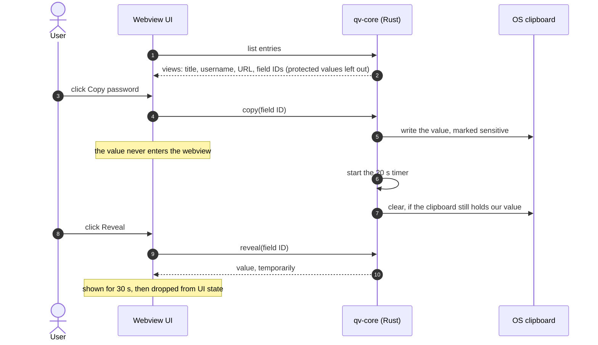

# 0008 — Memory Hygiene and Side Channels

| Status | Created | Depends on |
|--------|---------|------------|
| Draft | 2026-10-14 | 0001, 0002 |

## Summary

Rules for keeping secrets out of places they don't belong: freed memory, swap,
core dumps, logs, clipboard history, screenshots, keyboards, and timing.
Includes the **secret boundary** design between Rust core and the webview UI.

## Specification

### 1. Memory

1.1. All key material and decrypted secret values MUST be held in types that
zeroize on drop (`zeroize`, `secrecy::SecretBox`). `Debug`/`Display` on these
types MUST print redacted placeholders.

1.2. Long-lived key material (VK, purpose keys) SHOULD be in memory locked
against swapping (`mlock` / `VirtualLock`), via one small `unsafe` module
(`qv-crypto::locked`). Failure to lock MUST be logged (without secrets) and
not be fatal.

1.3. Avoid hidden copies: no `String` reallocation for secrets (pre-sized
buffers), no cloning of secret types.

1.4. Processes SHOULD disable core dumps and debugger attachment where the OS
allows (`prctl(PR_SET_DUMPABLE, 0)` on Linux, equivalents elsewhere).

1.5. On lock: zeroize the in-memory index, purpose keys and VK; drop
UI-held revealed values.

### 2. Timing

2.1. Secret-dependent comparisons MUST use constant-time operations
(`subtle`). Crypto crates used MUST be constant-time implementations.

2.2. Server: responses for unknown accounts/devices MUST be indistinguishable
in content and timing from failed attempts on existing ones.

2.3. Search over decrypted data is in memory and is not considered
timing-sensitive (attacker would need code on the device, out of scope).

### 3. OS leaks

| Channel | Rule |
|---------|------|
| Clipboard | Copy marks the content as sensitive (Android `ClipDescription.EXTRA_IS_SENSITIVE`, Windows `ExcludeClipboardContentFromMonitorProcessing` / no-history formats, KDE `x-kde-passwordManagerHint`). Auto-clear after 20 s (configurable), only if the clipboard still holds our value. |
| Screenshots / recents | Android `FLAG_SECURE`; hide content in app switcher on iOS/macOS/Windows where possible. |
| Keyboard | Secret inputs use no-personalized-learning / password input types (Android `IME_FLAG_NO_PERSONALIZED_LEARNING`). |
| Logs & crash reports | Never contain secrets; secret types are redacted by construction (1.1). |
| Temp files | Never write plaintext to disk. Export writes directly to the user-chosen path. |
| Auto-lock | On inactivity timeout, system sleep, screen lock, and (mobile) going to background after a grace period. All configurable. |

### 4. The secret boundary (UI)

Dioxus desktop/mobile renders in a webview; anything rendered there is a
JavaScript value outside Rust's control.

4.1. `qv-core` exposes data to frontends as **views** with non-secret
metadata and **handles** for protected fields (0003 §5 `protected`).

4.2. Protected values reach the UI only on an explicit, user-initiated
**reveal**, for a limited time (auto-hide, default 30 s), and are cleared from
the UI state afterwards.

4.3. **Copy** and **autofill** do not go through the UI: the UI sends
`copy(field_handle)` and Rust writes directly to the OS clipboard / autofill
response.

4.4. Password **input** (master password, editing a secret) is unavoidably
typed into the webview. Keep it to the shortest time possible, clear inputs
immediately after use.

> **Open design area.** Revisit before UI work starts. Options include a
> native (non-webview) secure input widget, Dioxus native rendering (Blitz)
> once mature, or accepting the webview exposure as within the "unlocked
> device" boundary of 0001.

## Security Considerations

Much of this is best-effort: garbage-collected webview memory, OS keyboard
caches and compositor buffers cannot be fully controlled. The rules above
reduce the window and number of copies; they do not defend against T-out-of-
scope malware on an unlocked device (0001).

## Open Questions

1. The secret boundary (§4) — accept, refine or replace.
2. Linux: no standard way to mark clipboard content sensitive outside KDE —
   what's the fallback on GNOME/wlroots?

## Changelog

- 2026-10-14: Initial draft.
- 2026-10-14: CLI prints secrets only with `--reveal` (0009 §3).
- 2026-10-14: Secret boundary as a Mermaid diagram.
